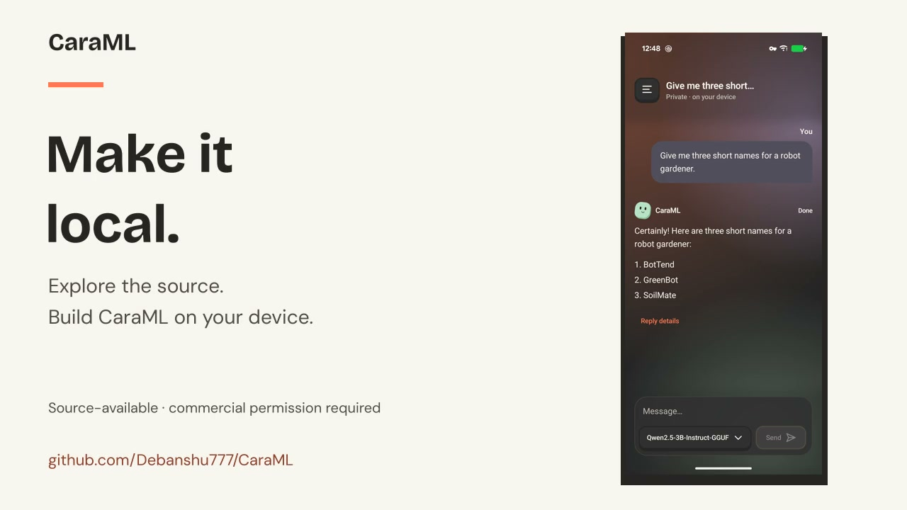
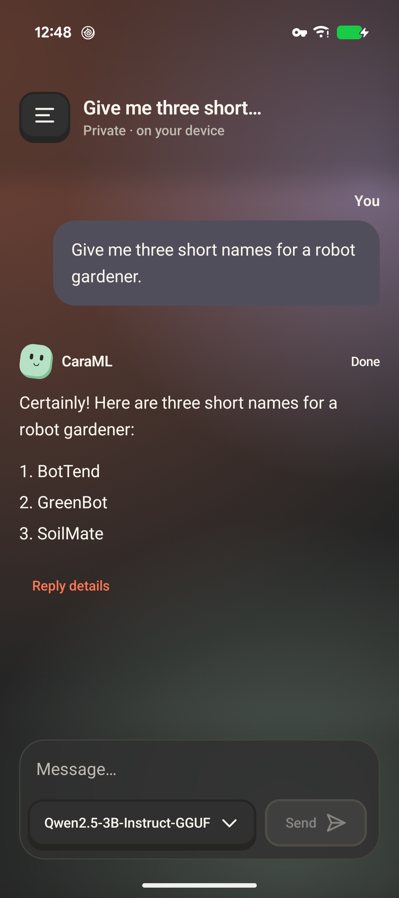
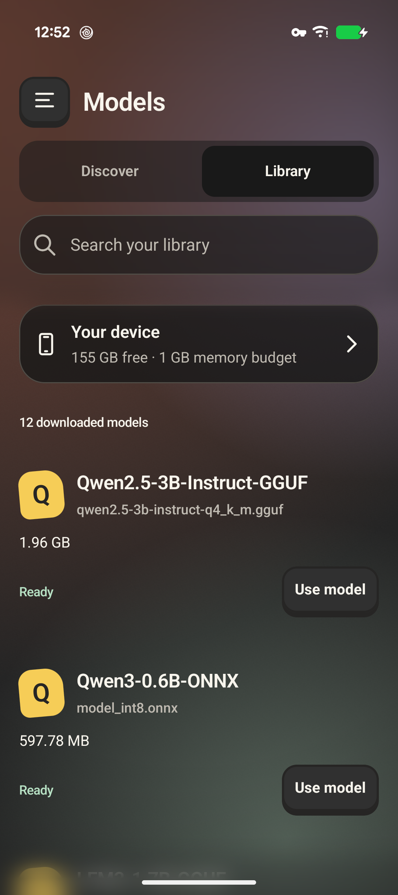
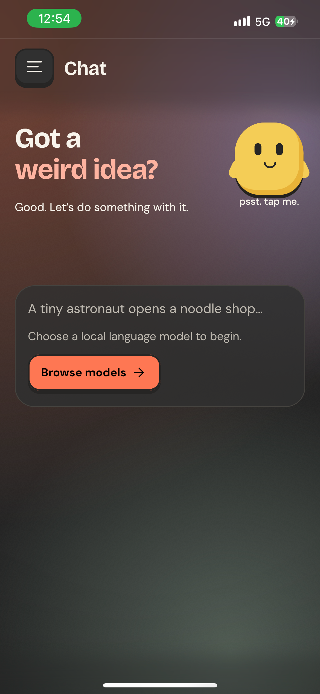

<p align="center">
  
</p>

# CaraML — local AI for Kotlin Multiplatform

**Run language models and image generation on Android, iOS, and desktop.**

CaraML is a **Kotlin Multiplatform / Compose Multiplatform AI app** powered by **llama.cpp**, **ONNX Runtime**, and **stable-diffusion.cpp**. Discover models on **Hugging Face**, download a supported model, and run inference locally. No cloud inference backend is required.

[](https://github.com/Debanshu777/CaraML/actions/workflows/ci.yml)
[](https://github.com/Debanshu777/CaraML/actions/workflows/docs.yml)
[](https://kotlinlang.org/multiplatform/)
[](LICENSE)

[**Get started**](docs/getting-started.md) · [**Documentation**](docs/index.md) · [**Demo**](docs/demo.md) · [**Contribute**](CONTRIBUTING.md) · [**Benchmarks**](benchmarks/README.md)

## See CaraML in action

[](docs/assets/caraml-demo.mp4)

**[Watch the demo](docs/assets/caraml-demo.mp4)** · [Transcript and capture details](docs/demo.md)

| Android · local chat | Android · model library | iPhone 13 · start |
| :---: | :---: | :---: |
|  |  |  |

Actual Pixel 9 and iPhone 13 app captures. The demo is an edited product walkthrough, not a performance benchmark.

## What you can do

- **Chat locally:** stream responses, render markdown and reasoning blocks, and stop generation.
- **Choose your models:** browse/search Hugging Face, filter files, and manage durable downloads with pause, resume, and recovery.
- **Generate images:** run supported diffusion models with model-specific settings and install plans.
- **Use native compute:** GGUF uses Vulkan on supported Android devices and Metal on Apple platforms; supported ONNX text exports currently use CPU in the app.
- **Explore shared Kotlin:** learn from Compose UI, coroutines, platform bridges, and an experimental modular inference SDK.

Model browsing and downloads need network access. Inference runs locally after download; gated models may require a Hugging Face token and acceptance of model terms. [Supported formats and memory considerations](docs/models.md).

## Quick start

CaraML currently ships as source. There are **no published binary releases or Maven Central SDK coordinates**. The SDK API is experimental.

Install a full **JDK 21**, a C/C++ compiler and CMake, and the Android SDK required by the full Gradle project. See [platform setup](docs/getting-started.md) for exact SDK/NDK versions.

```bash
git clone https://github.com/Debanshu777/CaraML.git
cd CaraML
git submodule update --init

# macOS/Linux desktop; builds native engines automatically
./gradlew :app:desktopApp:run

# Android: CPU build for the first run
./gradlew :app:androidApp:assembleDebug -PcaramlAndroidBackend=cpu
```

For Android Vulkan or iOS, follow [Build and run](docs/getting-started.md). Open **Models**, download a supported instruct model, then select it in **Chat**.

## Platforms

| Target | Current scope |
| --- | --- |
| Android API 28+ | arm64-v8a and x86_64; physical Pixel 9 measurements; Vulkan/CPU GGUF |
| iOS 17.2+ | arm64 device and Apple Silicon simulator; Metal GGUF; documented iPhone 13 measurements |
| macOS JVM | Desktop app and native Metal path |
| Linux JVM | CPU desktop path; JVM/native checks in CI |
| Windows JVM | Packaging configured; installed release validation remains outstanding |

ONNX support is limited to [specific causal text bundles](plugin-onnx/README.md). Video generation is not presented as a validated feature. Platform targets are not a guarantee that every Hub model works.

## Developer guide

| Goal | Documentation |
| --- | --- |
| Build and have your first conversation | [Getting started](docs/getting-started.md) |
| Select a compatible model | [Model guide](docs/models.md) |
| Understand modules and native bridges | [Architecture](docs/architecture.md) |
| Explore SDK contracts | [core-api](core-api/README.md), [core](core/README.md), [storage](storage/README.md) |
| Work on model discovery | [model-discovery](model-discovery/README.md) |
| Work on inference engines | [llama](plugin-llama/README.md), [ONNX](plugin-onnx/README.md), [diffusion](plugin-diffusion/README.md), [native builds](nativeEngine/README.md) |
| Change shared UI or platform hosts | [App](app/README.md), [shared Compose app](app/composeApp/README.md) |
| Fix an issue or add a feature | [Contributing](CONTRIBUTING.md), [testing](docs/development.md), [troubleshooting](docs/troubleshooting.md) |

```bash
# Preferred full local/CI JVM gate
./gradlew verifyProject

# Portable SDK tests without app/native producer configuration
./gradlew -PsdkOnly=true verifySdk
```

Android assembly, iOS compilation, packaging, and real-model journeys are separate checks. [Validation scope](docs/development.md).

## Current Android Benchmarks

Read the [current performance report](benchmarks/README.md), [ONNX/GGUF comparison](benchmarks/onnx/README.md), and [diffusion results](benchmarks/diffusion/README.md) for exact devices, model files, workloads, raw results, and limitations. The [earlier GGUF baseline](docs/benchmarks.md) is retained with its original measurement conditions. Decode rate, model load, and time to first token are different measurements.

## Architecture

Application code lives under `app/`; reusable contracts, orchestration, discovery, storage, and engine adapters are root modules. Both C++ engines share one GGML build. [Module map and data flows](docs/architecture.md).

### Package Conventions

First-party packages use `com.debanshu777.caraml`, with reusable libraries under `sdk.*`. Source paths mirror package names. [Full conventions](docs/architecture.md#package-conventions).

### SDK Boundaries and Ownership

Hosts own UI, persistence, permissions, and scheduling. The experimental SDK separates neutral contracts, resource admission, storage, discovery, and engine adapters. [Ownership and dependencies](docs/architecture.md#sdk-boundaries-and-ownership).

### Current SDK Limits

The SDK is experimental, not a published stable dependency. Durable storage/recovery, iOS resource factories, complete app migration, independent native packaging, and release conformance remain unfinished. [Detailed limits](docs/architecture.md#current-sdk-limits).

### Verification Status

Historical benchmark/device results do not certify a release. Check [CI](https://github.com/Debanshu777/CaraML/actions), [test scope](docs/development.md), and the conditions in each benchmark report before drawing platform or performance conclusions.

## License

**Source-available under [PolyForm Noncommercial 1.0.0](LICENSE).** Noncommercial use, modification, and sharing are permitted under its terms. Commercial use requires separate written permission. [License details and permission requests](docs/licensing.md).

Dependencies and model weights retain their own licenses; see [third-party notices](THIRD_PARTY_NOTICES.md). This project is not licensed as OSI-approved open source.

## Recent Changes

- Added a visual project overview, real-device demo, searchable documentation, platform setup, contribution templates, and documentation checks.
- Added PolyForm Noncommercial licensing and an explicit commercial-permission route.
- Enabled Android Vulkan image generation and model-specific sampling; [results and limits](benchmarks/diffusion/README.md).
- Added supported ONNX text bundles and measured model-loading improvements; [performance report](benchmarks/README.md).
