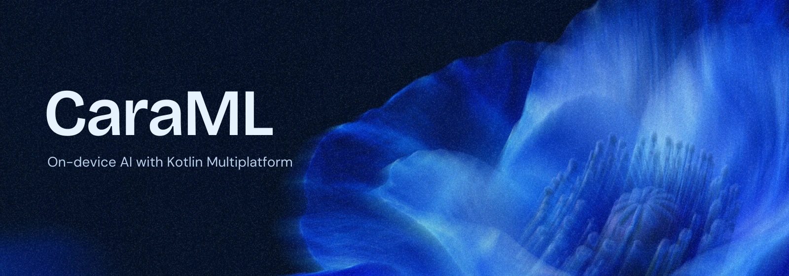
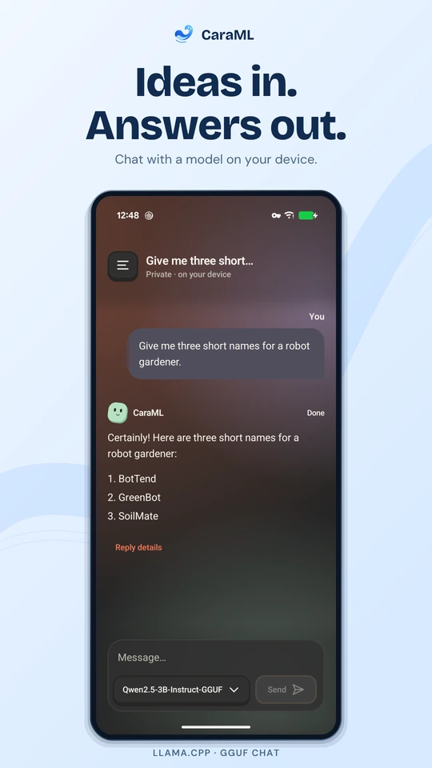
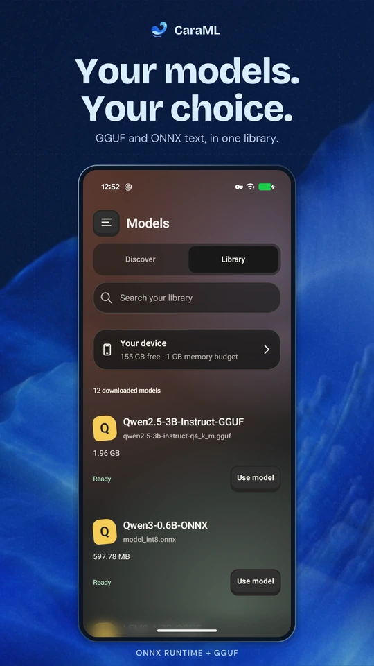
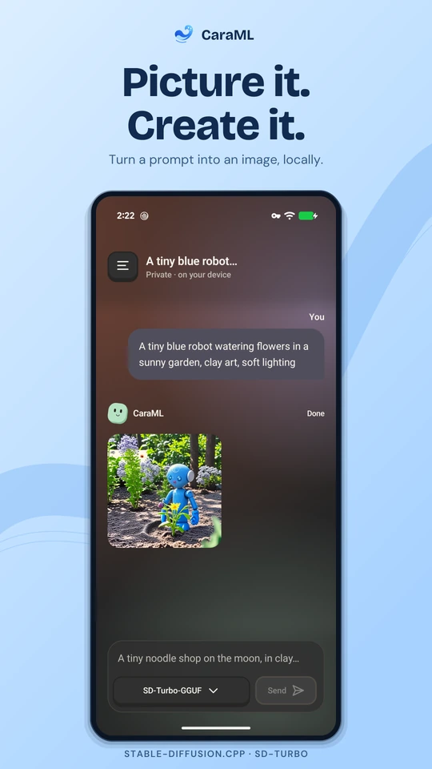
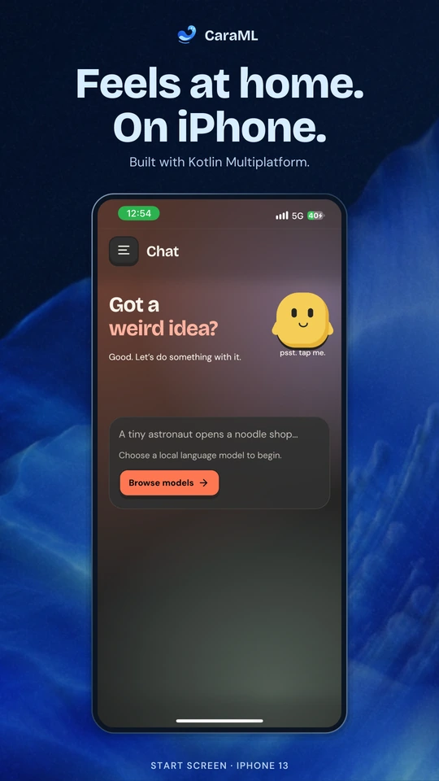

<p align="center">
  <a href="docs/assets/readme-banner.png"></a>
</p>

<p align="center">
  <strong>Chat with language models and generate images on your own hardware.<br>
  Built with Kotlin Multiplatform for Android, iOS, and desktop.</strong>
</p>

<p align="center">
  <a href="https://kotlinlang.org/multiplatform/"></a>
  <a href="#platforms"></a>
  <a href="LICENSE"></a>
</p>

<p align="center">
  <a href="https://debanshu777.github.io/CaraML/"><strong>Documentation</strong></a> &nbsp;·&nbsp;
  <a href="#get-started"><strong>Get started</strong></a> &nbsp;·&nbsp;
  <a href="https://debanshu777.github.io/CaraML/demo/"><strong>Watch the demo</strong></a> &nbsp;·&nbsp;
  <a href="CONTRIBUTING.md"><strong>Contribute</strong></a>
</p>

<br>

## At a glance

- **Chat locally.** Stream answers, render reasoning and markdown, and stop a response at any time.
- **Find your model.** Explore Hugging Face, download supported models, and manage your library.
- **Create images.** Run supported diffusion models with model-specific settings on your device.
- **Build with shared Kotlin.** Explore Compose Multiplatform UI and native inference across three platforms.

| Engine | What you can run |
| --- | --- |
| **llama.cpp** | Local chat with GGUF language models |
| **ONNX Runtime** | Text generation with supported ONNX bundles |
| **stable-diffusion.cpp** | Image generation with supported diffusion models |

Model discovery and downloads need a connection; inference runs locally once the model is downloaded. [Formats and compatibility →](docs/models.md)

## See it in action

<p align="center">
  <a href="docs/assets/product/01-local-chat.png"></a>
  <a href="docs/assets/product/02-model-library.png"></a>
  <a href="docs/assets/product/03-image-generation.png"></a>
  <a href="docs/assets/product/04-iphone.png"></a>
</p>

[**Watch the 32-second walkthrough →**](https://debanshu777.github.io/CaraML/demo/) &nbsp; Local chat and image generation on a Pixel 9, with captions and a transcript.

<details>
<summary>About these screenshots</summary>

Store-style layouts around actual Pixel 9 and iPhone 13 captures. Select a card for its full-size PNG. The iPhone capture shows the initial chat screen; [capture notes and original screenshots](docs/demo.md#product-screenshots) provide the details. The app retains its current appearance in these captures.

The video is edited for readability; measured performance lives in the [benchmark reports](benchmarks/README.md).

</details>

## Get started

CaraML is currently distributed as source. Set up **JDK 21**, the Android SDK, CMake, and a C/C++ compiler using the [platform setup guide](docs/getting-started.md), then:

```bash
git clone https://github.com/Debanshu777/CaraML.git
cd CaraML
git submodule update --init

# Run on macOS or Linux; native engines build automatically
./gradlew :app:desktopApp:run
```

For Android, start with a CPU build:

```bash
./gradlew :app:androidApp:assembleDebug -PcaramlAndroidBackend=cpu
```

Open **Models**, download a supported instruct model, and select it in **Chat**. The [build guide](docs/getting-started.md) covers Android Vulkan, iOS signing, and the first conversation.

## Platforms

| Platform | Available today |
| --- | --- |
| **Android 9+** | arm64 and x86_64 · Vulkan / CPU GGUF |
| **iOS 17.2+** | arm64 devices and Apple Silicon simulators · Metal GGUF |
| **Desktop JVM** | macOS Metal · Linux CPU · Windows packaging awaits release validation |

Supported ONNX text bundles currently use CPU in the app. See [model compatibility](docs/models.md) for export requirements and [device benchmarks](docs/benchmarks.md) for measured workloads.

## For developers

Start with the [architecture guide](docs/architecture.md), [contributing guide](CONTRIBUTING.md), or [troubleshooting](docs/troubleshooting.md). The SDK is experimental; standalone Maven artifacts and binary app releases are not published yet.

```bash
./gradlew verifyProject                  # Full local/CI JVM gate
./gradlew -PsdkOnly=true verifySdk       # Portable SDK checks
```

<details>
<summary>Explore the modules and SDK boundaries</summary>

### Architecture

| Area | Modules |
| --- | --- |
| App and shared UI | [App](app/README.md) · [Compose app](app/composeApp/README.md) |
| SDK contracts and lifecycle | [core-api](core-api/README.md) · [core](core/README.md) · [storage](storage/README.md) |
| Models and native engines | [discovery](model-discovery/README.md) · [llama](plugin-llama/README.md) · [ONNX](plugin-onnx/README.md) · [diffusion](plugin-diffusion/README.md) · [native builds](nativeEngine/README.md) |

### Package Conventions

First-party packages use `com.debanshu777.caraml`; reusable libraries live under `sdk.*`. [Full conventions](docs/architecture.md#package-conventions).

### SDK Boundaries and Ownership

Hosts own UI, persistence, permissions, and scheduling. The SDK separates contracts, admission, storage, discovery, and engine adapters. [Ownership guide](docs/architecture.md#sdk-boundaries-and-ownership).

### Current SDK Limits

The SDK does not promise stable APIs. Durable recovery, full app migration, standalone packaging, and release conformance remain in progress. [Detailed limits](docs/architecture.md#current-sdk-limits).

### Verification Status

The JVM gate does not replace Android, iOS, packaging, or real-device checks. See [CI](https://github.com/Debanshu777/CaraML/actions) and the [testing guide](docs/development.md) for scope.

### Current Android Benchmarks

[Performance overview](benchmarks/README.md) · [ONNX / GGUF](benchmarks/onnx/README.md) · [Diffusion](benchmarks/diffusion/README.md). Each report records its workload, hardware, and limitations.

</details>

## License

Source-available under [**PolyForm Noncommercial 1.0.0**](LICENSE). Noncommercial use is permitted under its terms; commercial use requires separate written permission. [License details and permission requests](docs/licensing.md).

Dependencies and model weights keep their own licenses. See [third-party notices](THIRD_PARTY_NOTICES.md).

## Recent Changes

- Required docs, root README, and affected module README updates alongside every code change through the shared agent and contributor workflow.
- Fixed the ONNX resident-session test storage layout on Linux CI and enabled complete JVM test failure diagnostics.
- Published the [documentation and demo on GitHub Pages](https://debanshu777.github.io/CaraML/), with source links pinned to each deployed revision.
- Simplified the README and docs around a compact blue-flower masthead, project details, and direct setup links.
- Fixed nested diffusion-model installs and kept image/video models visible alongside frequently used chat models.
- Added searchable docs, a real-device demo, contribution guides, and noncommercial licensing.
- Added ONNX text support and Android Vulkan diffusion; [results and limits](benchmarks/README.md).

---

<p align="center"><sub>Built by <a href="https://github.com/Debanshu777">Debanshu Datta</a> with Kotlin &amp; Compose Multiplatform.</sub></p>
