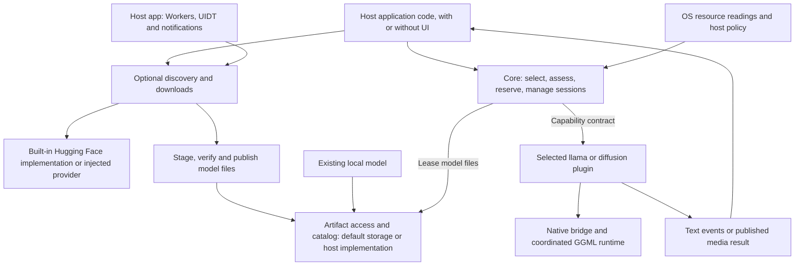
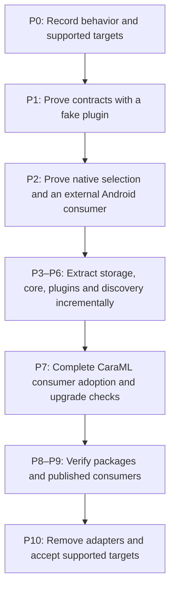
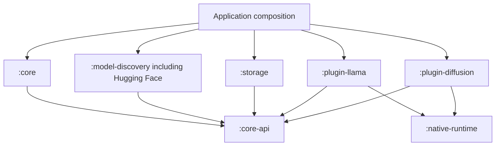
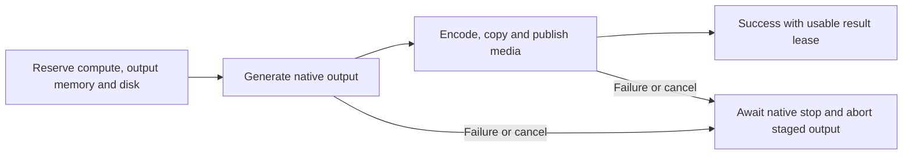
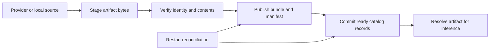

# Generic on-device inference library: architecture and extraction plan

Date: 2026-10-14

Status: Implementation in progress; experimental portable SDK and native feasibility work added. No full phase acceptance or application migration is claimed. See [implementation evidence](docs/sdk/implementation-evidence.md).

Companion checklist: [evalutaion.md](evalutaion.md)

**Scope boundary:** The library is a reusable SDK for any Android, iOS or JVM consumer. CaraML is one consuming application and the source of code being evaluated for extraction. Its UI, preference files, database schemas and migration history are not SDK requirements. Source references below explain extraction risks; host-specific preservation work is tracked separately from library acceptance.

## Architecture review — 2026-10-14

**Assessment:** The dependency direction, optional engines, storage boundaries, and early native feasibility work are appropriate. Proceed with P0–P2 feasibility work; defer broad extraction until its contract and external-consumer gates pass. The target module list is a responsibility map, not a requirement to publish every implementation separately. Prefer a small working consumer before freezing more public abstractions.

**Current review:** Retain R1–R19 and add R20–R21 for independent SDK consumption: native backend loading must remain inside the SDK's declared binary set, including when other native SDKs are installed; and hosts need control of discovery's transport and its lifetime. Strengthen R9/R11 with API maturity rules, consumer-toolchain tests and externally usable extension conformance tests. These are source-based risks and planning gaps, not reproduced device failures. The resolutions below are proposed requirements, not implemented fixes. Keep the existing runtime module boundaries and phase sequence.

**Module boundary decision:** Bundle the Hugging Face implementation inside `:model-discovery` behind a provider interface. Discovery consumers receiving its Hugging Face dependencies is an accepted design decision. Keep Android durable-work components and scheduling policy in the consuming application. Neither responsibility requires a separately published module in the initial library release; the lifecycle, isolation and upgrade gates below still apply.

Priorities describe migration risk: **P1** must be resolved before the affected extraction; **P2** must be resolved before the corresponding release gate.

| ID | Priority | Finding and concrete consequence | Resolution / gate |
|---|---|---|---|
| R1 | P1 | [Android download runtime](composeApp/src/androidMain/kotlin/com/debanshu777/caraml/core/download/AndroidDownloadRuntime.kt) uses app Koin, persisted worker names, service components, and generation markers. Moving classes or requiring an Activity can strand scheduled work after upgrade/background startup. | Explicit Android integration ownership and identity compatibility; sections 6 and 9; P3/P6/P7 |
| R2 | P1 | [llama native state](plugin-llama/src/commonCpp/llama_runner_core.cpp) has process-wide model/context/configuration and cancellation state. A mutex per new session or core instance cannot provide independent sessions. | Process-wide plugin lease and advertised capacity, atomic resource reservation, safe cancellation; section 4; P1/P4/P5 |
| R3 | P1 | [JNI](plugin-llama/src/commonCpp/llama_runner_jni.cpp) looks up configuration fields by name; [diffusion JNI](plugin-diffusion/src/commonCpp/diffusion_runner_jni.cpp) also looks up classes/constructors. [Android release builds](androidApp/build.gradle.kts) currently disable minification, leaving a published SDK's R8 behavior unproven. | Preserve bridge identities during moves, ship narrow consumer rules, run an optimized external consumer; section 8; P2/P8/P9 |
| R4 | P1 — CaraML migration only | CaraML's [inference preferences](composeApp/src/commonMain/kotlin/com/debanshu777/caraml/core/data/settings/DefaultSettingsRepository.kt), [theme preferences](composeApp/src/commonMain/kotlin/com/debanshu777/caraml/core/data/theme/DefaultThemeRepository.kt) and recovery state currently share one app-owned DataStore. Extraction must not introduce a second owner for that existing file. | Keep preferences and DataStore ownership in CaraML; adapt recovery state as needed. This is not a library API/storage requirement; appendix A; P3/P7 |
| R5 | P1 | A Flow return type does not settle execution ownership, repeat collection, slow collectors, or terminal cleanup. [Current generation](composeApp/src/commonMain/kotlin/com/debanshu777/caraml/core/data/inference/LlamaInferenceRepository.kt) holds a session gate across collection and finalizes in `finally`. | Explicit operation and stream semantics, cancellation completion, lifecycle policy; sections 4 and 9; P1/P4/P7 |
| R6 | P2 | Moving all diffusion setup rules into a native plugin conflicts with discovery-only bundle installation. Existing [artifact identity](composeApp/src/commonMain/kotlin/com/debanshu777/huggingfacemanager/download/DownloadArtifactIdentity.kt) also requires a Git-like hex revision, so merely renaming it is not provider-neutral. | Native-free artifact planning, opaque provider revision, separate local identity; sections 5 and 6; P1/P6 |
| R7 | P2 | “Validated file access” leaves native path/URI adaptation, file lifetime after load, custom-store transactions, and backup restore unspecified. Losing these guarantees can create stale or deletable load targets. | Leased artifacts, transactional store contracts, managed import policy, restore reconciliation; section 5; P3/P5 |
| R8 | P2 | Existing [native build flags](nativeEngine/build.gradle.kts) and [app packaging](androidApp/build.gradle.kts) encode 16 KB support and extracted backend discovery. Those assumptions can be lost when distributing separate AARs. | Inspect every shipped binary and AAB-derived install, pin ABI/runtime ownership; section 8; P2/P8 |
| R9 | P2 | The initial sequence deferred external publication checks until P9, after most extraction. SDK minimums, binary compatibility, and a consumer without Koin need evidence much earlier. | Early published vertical slice after P2, API maturity and consumer-toolchain baseline, staged adoption and maintenance ownership; sections 1 and 10–11; P1/P2/P9/P10 |
| R10 | P1 | [Native configuration](nativeEngine/build.gradle.kts) resolves CMake eagerly, while [runner](runner/build.gradle.kts) uses the single-variant Android KMP plugin. Merely adding core modules or proposing engine flavors does not establish independent configuration or a viable Android native artifact layout. | Lazy native tool validation; standalone Android native AAR producers; explicit dependency selection and test discovery; section 8; P1/P2/P8 |
| R11 | P1 | Existing [descriptors](composeApp/src/commonMain/kotlin/com/debanshu777/caraml/core/recommendation/ModelDescriptor.kt), [workloads](composeApp/src/commonMain/kotlin/com/debanshu777/caraml/core/recommendation/WorkloadConfig.kt), and [plans](composeApp/src/commonMain/kotlin/com/debanshu777/caraml/core/recommendation/RunPlan.kt) form closed engine-specific hierarchies. Open engine IDs alone cannot deliver third-party plugins or typed plugin options without core edits. | Define the host API versus plugin implementation contract; prove custom options, metadata and plan admission end to end; distribute external conformance support; sections 4 and 11; P1/P4/P5/P9 |
| R12 | P1 | [ModelRecommendationService](composeApp/src/commonMain/kotlin/com/debanshu777/caraml/features/modelhub/domain/ModelRecommendationService.kt) accepts Hugging Face models and produces UI state; [ModelMetadataSource](composeApp/src/commonMain/kotlin/com/debanshu777/caraml/features/modelhub/domain/ModelMetadataSource.kt) imports a presentation browse mode. Its target ownership is missing, risking a core/discovery cycle or lost recommendations. | Split remote enrichment, engine assessment, reusable ranking, and screen query state; section 7; P4/P6/P7 |
| R13 | P1 | [ManageContextUseCase](composeApp/src/commonMain/kotlin/com/debanshu777/caraml/features/chat/domain/usecase/ManageContextUseCase.kt) and [llama repository](composeApp/src/commonMain/kotlin/com/debanshu777/caraml/core/data/inference/LlamaInferenceRepository.kt) coordinate destructive summarization/reset while native code owns chat templates/history. A generic text stream leaves history authority and settings changes ambiguous. | Specify stateful turn input, template ownership, configuration snapshots and exclusive context replacement; section 4; P1/P5/P7 |
| R14 | P1 | [Android device resources](composeApp/src/androidMain/kotlin/com/debanshu777/caraml/core/platform/DeviceCapabilities.android.kt) use global Koin; [snapshot collection](composeApp/src/commonMain/kotlin/com/debanshu777/caraml/core/recommendation/DeviceSnapshotProvider.kt) imports Hugging Face storage. Unassigned platform defaults can retain those dependencies or silently substitute memory guesses in a minimal consumer. | Place replaceable OS resource defaults in core platform source sets, inject storage metrics, and define pressure behavior without guaranteed trim callbacks; sections 3 and 9; P1/P2/P4/P7 |
| R15 | P1 | Both [llama](plugin-llama/src/commonCpp/llama_runner_core.cpp) and [diffusion](plugin-diffusion/src/commonCpp/diffusion_runner_core.cpp) initialize the shared backend registry and change logging callbacks. In the pinned source, [llama_log_set](libraries/llama.cpp/src/llama-impl.cpp) also sets GGML's global logger. Separate engine locks and one packaged GGML binary do not prevent cross-engine mutation of this state. | Give shared native initialization, callbacks and teardown one owner; serialize shared-runtime operations initially, including probes; section 8; P2/P5/P8 |
| R16 | P2 | [Diffusion generation](composeApp/src/commonMain/kotlin/com/debanshu777/caraml/core/data/inference/DiffusionInferenceRepository.kt) returns bytes/frame lists and the [ViewModel](composeApp/src/commonMain/kotlin/com/debanshu777/caraml/features/chat/presentation/ChatViewModel.kt) saves them afterward. Releasing all transient reservations at native completion misses retained output/copy memory and disk publication; a successful native call can still fail to produce a usable result. | Bounded media-output contract, explicit publication stage, result metadata and retention ownership; sections 4–5; P1/P3/P5/P7 |
| R17 | P1 | [Load recovery](composeApp/src/commonMain/kotlin/com/debanshu777/caraml/core/recommendation/LoadRecoveryRepository.kt) increments suspected-failure counts for an unfinished marker and can classify repeated interruptions as `KNOWN_UNSTABLE`. Process death during load alone does not identify a faulty model/backend; in-process native aborts also cannot become ordinary Flow errors. | Explicit fault boundary and evidence-based recovery policy, including unknown exits and same-process clients; section 7; P1/P4/P7 |
| R18 | P1 | [Android](nativeEngine/src/androidMain/cpp/CMakeLists.txt) and [desktop](nativeEngine/src/jvmMain/cpp/CMakeLists.txt) infer Vulkan support from installed tools/headers; the Android `SD_VULKAN ON` setting contradicts its disabled-backend comment. [Pinned GGML defaults](libraries/llama.cpp/ggml/CMakeLists.txt) also permit host CPU tuning. ABI and engine selection alone do not define a portable, reproducible SDK binary. | Explicit backend/CPU build profile, baseline-safe dispatch and capability provenance; section 8; P0/P2/P8 |
| R19 | P2 | [Llama JNI](plugin-llama/src/commonCpp/llama_runner_jni.cpp) passes generated UTF-8 to `NewStringUTF`; both it and [diffusion JNI](plugin-diffusion/src/commonCpp/diffusion_runner_jni.cpp) use `GetStringUTFChars` for native inputs. JNI modified UTF-8 differs from standard UTF-8, so emoji, paths and streamed text need more than ASCII parity/R8 tests. | Defined string/byte conversion, incremental decoding and malformed-input policy; section 4; P1/P5/P8 |
| R20 | P1 | [Android native packaging](nativeEngine/src/androidMain/cpp/CMakeLists.txt) uses generic GGML libraries; the pinned [backend loader](libraries/llama.cpp/ggml/src/ggml-backend-reg.cpp) scans matching filenames, opens candidates before scoring them and accepts `GGML_BACKEND_PATH`. Coordination between our two engines does not stop a foreign backend in the host's native directory from being loaded or an unrelated SDK from conflicting with exported symbols/STL. | SDK-owned backend allowlist, binary names/export surface and C++ runtime policy; coexistence fixture before freezing native artifacts; section 8; P2/P8/P9 |
| R21 | P2 | [Provider construction](model-discovery/src/commonMain/kotlin/com/debanshu777/huggingfacemanager/HuggingFaceApi.kt) and [Android downloads](composeApp/src/androidMain/kotlin/com/debanshu777/huggingfacemanager/download/DownloadManager.android.kt) create separate HTTP clients internally. Provider injection and generic ownership prose do not prove that the built-in provider and transfers use a host's transport policy or share a bounded retry budget. | Explicit transport injection/configuration, borrowed-client lifetime, request accounting and host network-policy tests; section 6; P1/P6/P9 |

## 1. Objective and agreed direction

Build a generic KMP library ecosystem by extracting reusable inference, model discovery and artifact-management logic. Any consumer selects the engines, discovery services and persistence implementations it needs, with or without a UI. Migrating CaraML without regressions is a separate consumer-integration workstream, not the definition of the public library API.

The application chooses and wires `:core`, optional `:model-discovery`, default `:storage` or consumer implementations, and at least one engine plugin when inference is required. `:core-api` supplies the shared contracts. Core must never depend on concrete plugins, runner modules, Room, DataStore, Hugging Face, or native inference build outputs.

The agreed name is `:model-discovery`, not `:model-downloader`. Its responsibilities include discovery, artifact resolution, and download orchestration, with a built-in Hugging Face implementation. Provider-specific code remains separated from generic transfers by interfaces and internal packages within this module.

### Library versus host ownership

| Library owns | Host application owns |
|---|---|
| Typed model identities, capability requests, inference options and results | UI state, screens, navigation, themes, chat transcript presentation and onboarding |
| Configuration validation, effective options and per-operation snapshots | Selecting defaults, reading/saving user preferences and mapping them to typed requests |
| Generic catalog/artifact/task/recovery/calibration contracts and optional implementations | Existing application schemas/files, migrations and adapters to those contracts |
| Discovery, transfer/resume and durable task execution | OS scheduling, notifications, permissions and application DI |

Do not move `AppSettings`, `ChatMessage`, `RecommendedModelUiState`, `ModelHubBrowseMode`, theme settings or onboarding flags into library modules. Extract only neutral values needed by execution; keep application DTO mapping in the host. Core receives immutable typed configuration rather than reading a global settings repository. The initial SDK has no required inference-preferences store and no knowledge of `app.preferences_pb` or CaraML preference keys. Operational recovery/calibration state remains distinct from user preferences.

Published libraries must neither depend on `:composeApp`/`:androidApp` nor package their classes, UI resources or legacy application schema definitions. Default library storage uses neutral domain records and a consumer-configured storage location; it does not open a known host file automatically. Existing consumers can adapt their own stores without adopting the default implementation. Verify this with an independent consumer that has no CaraML code, resources, database or preference file.

### Success conditions

- Core-only consumers can compile and use applicable services without inference native libraries.
- A local-model consumer can infer without Hugging Face, HTTP downloads, or the default database.
- A llama-only consumer neither builds nor packages diffusion inference code; the reverse also holds.
- Combined llama and diffusion configurations retain compatible GGML linkage.
- Adding an engine for an existing capability requires a plugin and registration, not edits to core's engine routing.
- Generic library persistence preserves its documented formats across supported SDK upgrades; CaraML's existing data preservation is evaluated separately in appendix A.
- Library consumption works outside this repository with published artifacts.
- A third-party fake text plugin supplies its own metadata/options/plan through admission and generation without adding engine cases to core; registration alone is insufficient evidence.

### Scope limits

This migration does not implement ONNX, TensorFlow, new chat persistence, a UI redesign, or runtime downloading of executable plugins. Plugins are build-time library dependencies registered at startup. Future engines may introduce new capability contracts when their tasks cannot be expressed by existing ones.

### First deliverable and API maturity

The first end-to-end SDK milestone is P2's external Android/Kotlin local-file llama sample with real resource readings and optimized native packaging. Prove that path before expanding the public API to every existing application service. The full matrix remains the target architecture; P0 explicitly selects the first release's platforms, ABIs, capabilities and consumer languages. Java callers, direct Swift, desktop targets and video are supported only when selected and tested, not merely because a JVM/KMP artifact exists. This is a sequencing recommendation, not an implicit reduction of the agreed platform goals.

Before publishing even an alpha, label application-facing APIs, engine/provider/store implementation contracts, and internal bridges separately. Proposed policy: alpha APIs may change with migration notes; any unproven extension surface carries a documented `@RequiresOptIn` marker; a stable release follows the declared source/binary/behavioral compatibility and deprecation policy. Internal bridges are not supported integration points even when their artifacts must be distributed transitively. Do not stabilize every type in the contract inventory at once. Kotlin's [library evolution guidance](https://kotlinlang.org/docs/api-guidelines-backward-compatibility.html) distinguishes these compatibility obligations and supports explicit opt-in for evolving APIs.

### Overall plan in pictures

The application remains the composition root: it selects implementations and injects them. This picture shows **runtime interactions**, not Gradle dependencies. All replaceable boundaries use `:core-api`; the compile-dependency graph is in section 3.



A local text consumer uses core, the llama plugin, platform resources and caller-provided artifact access. Discovery and default Room/DataStore storage are optional; Android durable-download integration is app-owned. The inference loop does not call Hugging Face. The provider box above is an implementation boundary, not a separate published artifact.



P2 is the first major go/no-go point. A successful module build alone does not justify the extraction; the external consumer must load, generate, cancel and close using staged artifacts. App adoption starts as each workflow passes its gate, with P7 completing it.

## 2. CaraML source inventory and extraction constraints

This is an inventory of the existing consumer, not a required structure or data model for other hosts.

The original consumer had six Gradle projects, including `:runner` and `:diffusionRunner`. The current [settings](settings.gradle.kts) contain ten projects: three application/native projects plus seven SDK projects. On 2026-10-14, the two standalone bridge projects were absorbed into their engine plugins. The legacy Hugging Face project was also removed: provider APIs moved into discovery and host download/storage/install integrations moved into the app. Source packages and JNI names remain compatible.

| Existing area | Current role and coupling | Migration consequence |
|---|---|---|
| `composeApp/core` | Contains orchestration, repositories, storage, platform services, UI utilities, and DI | Classify by responsibility; do not move the whole directory into core |
| `InferenceRepository` | Exposes `runner.InferenceChunk` and text-specific context operations | Introduce neutral events and separate capability interfaces |
| `DiffusionInferenceRepository` | Concrete app dependency combining policy, component resolution, and runner calls | Extract a typed capability and separate shared policy from adapter logic |
| `AppModule` and platform DI | Construct both runners and all app services | Separate application composition from reusable library construction |
| Former `huggingFaceManager` packages | Hub API/metadata/factories now in discovery; platform downloads, secure filesystem and curated install helpers now in the app | Preserve app compatibility while migrating workflows to neutral SDK contracts |
| `plugin-llama` / `plugin-diffusion` bridge packages | Kotlin APIs plus JNI/cinterop and native bridges, moved from the former runner modules | Keep bridge implementation in its owning engine plugin |
| `nativeEngine` | Shared GGML, engine builds, patches, archive merging, and artifact filesystem | Separate storage native build; introduce selectable engine artifacts |
| `composeApp` Gradle | Direct native paths, iOS linking, desktop resource staging | Move reusable packaging into library/build infrastructure |
| `androidApp` Gradle | Also has debug dependencies on existing provider and runner modules | Audit debug and release graphs, not only shared app dependencies |
| Room databases | App v1, download v3, recommendation v1; schema export disabled and destructive fallback configured | Establish schema fixtures and a non-destructive upgrade policy before storage changes |

`libraries/` and `libraries/patches/` are source/build assets, not public Kotlin libraries. Current native builds intentionally coordinate a shared GGML implementation. Existing paths and task names must be treated as migration inputs rather than assumed permanent APIs.

## 3. Target modules and dependency rules

The bridge/plugin split was removed after review: each pair has one engine owner,
release cadence and platform dependency. Further folder nesting would not reduce
Gradle projects. Keep API/core separate for third-party plugins, keep storage and
discovery optional, and keep one native gate shared by both engines. Replacing the
remaining legacy application workflows depends on the P7 migration; retiring the provider project alone does not complete that migration.

| Module | Owns | Allowed project dependencies |
|---|---|---|
| `:core-api` | Portable models, errors, capabilities, lifecycle contracts, storage/provider interfaces | None |
| `:core` | Engine registry/selection, shared admission, load recovery coordination, session orchestration, observations, catalog operations; replaceable OS resource defaults in platform source sets | `:core-api` |
| `:model-discovery` | Browsing and download coordination, retries/resume, installation finalization/reconciliation; built-in Hugging Face API, metadata and source resolution behind provider interfaces | `:core-api`; HTTP libraries and platform transport implementations |
| `:storage` | Optional generic catalog, task, calibration/recovery, artifact and media storage implementations; no application preferences or UI data | `:core-api`, internal artifact filesystem build |
| `:plugin-llama` | llama capability and Kotlin/JNI/cinterop bridge, configuration mapping, preflight, calibration probe, metadata interpretation | `:core-api`, `:native-runtime`, selected native artifacts |
| `:plugin-diffusion` | Diffusion capabilities and Kotlin/JNI/cinterop bridge, execution component validation, configuration mapping, preflight, fit estimation | `:core-api`, `:native-runtime`, selected native artifacts |
| `:native-runtime` | Shared process-wide native ownership gate used by both engine plugins | None |
| `:composeApp` — CaraML consumer, not published SDK | Screens, ViewModels, UI state, navigation, appearance, preferences and app composition | Selected public modules |
| `:androidApp`, `iosApp`, desktop entry point | Platform startup and final app packaging; host-owned background scheduling/components, notifications and permissions | Application framework and selected public modules; Android scheduling libraries in host Android code |

Hugging Face is the initial built-in provider in `:model-discovery`, with neutral SDK interfaces and a separate retained compatibility API used by the app. Legacy DTOs remain public for source compatibility; they are not the custom-provider extension contract. Public discovery operations use neutral models; expose an explicit provider factory/configuration for authentication and allow injected alternatives. Generic orchestration calls `ModelProvider`, not Hugging Face classes. No network work or provider initialization is triggered merely by loading the module. Local inference omits `:model-discovery` entirely. Avoid making discovery depend on `:core` merely to reuse a service: expose a small contract or reconsider ownership instead.

This deliberately trades independent provider packaging for a smaller module surface: a discovery consumer using another provider still resolves the module's built-in Hugging Face/HTTP dependencies. Extract a separate provider artifact only when a real consumer needs that dependency isolation, independent release cadence or additional providers with substantial dependencies. Interface separation and testability do not require a Gradle module for each implementation. This is a project-specific application of Android's [cohesion and encapsulation guidance](https://developer.android.com/topic/modularization/patterns).

Android Workers, UIDT services, notifications, permissions and scheduling policy stay in host application code, initially at their existing CaraML Android source locations to preserve component identities. Generic downloads and local inference must not bring in WorkManager initialization, services, or notification permissions. Library `androidMain` code may still provide ordinary platform HTTP/file implementations; being Android-specific alone does not make code app-owned. Engine-specific, native-free artifact planners may use a small internal module shared by discovery and a plugin; add it only where the P6 consumer proves it necessary. Keep `:core-api` small: only contracts crossing module boundaries belong there, not every internal policy/helper.



Arrows above mean compile dependencies. Host Android download components are part of application composition; the Hugging Face implementation is inside discovery. Runtime calls from core reach plugin implementations through injected interfaces; they do not create a core-to-plugin compile dependency.

### Platform implementation ownership

Keep `DeviceResourceSource` and neutral readings in `:core-api`. Initially put default OS-only implementations and explicit factories in `:core`'s `androidMain`, `iosMain` and `jvmMain`; no new platform module is needed. Android construction accepts application context directly and never consults global Koin. Core's common orchestration remains injectable and testable with fake sources. Native backend capabilities remain plugin-owned, separate from OS readings; constructing a resource source must not initialize a runner.

Replace `DeviceSnapshotProvider`'s provider storage dependency with an injected storage-metrics contract implemented by default storage or the consumer for the actual artifact/output volume. Missing memory/thermal readings remain unknown with an explicit conservative admission outcome; a missing host integration must not become an invented safe memory budget. Listener registration belongs to the owning runtime, is shared across its facades, and is undone on close. Host download integration owns scheduling components only; local inference never needs it to receive resource updates. Host logging is injected, with no mandatory process-global logger configuration.

### Public API and DI rules

- Expose platform-neutral values and suspend/Flow APIs; do not expose native pointers, JNI integers, Room entities, or Ktor DTOs.
- Use stable typed IDs for engines, providers, artifacts, and models. Do not confuse GGUF format identity with llama engine identity.
- Keep constructors/factories usable without Koin. The application may continue using Koin to compose them.
- Use `api` dependencies only where required by exposed signatures; keep implementation details internal. Published metadata must still deliver required runtime dependencies.
- Avoid an enum or sealed list of engine implementations that requires core edits for every new plugin. Capability contracts may be typed and evolve independently.
- Preserve cancellation and exception semantics through adapters; map native failure codes to documented typed errors.

### Builder-based consumer API

Provide cohesive builders inspired by OkHttp/Retrofit construction: a host opts into capabilities and supplies dependencies, then receives an immutable configured client. Use `InferenceClient.Builder` for inference and `ModelDiscovery.Builder` for optional discovery. These services can share injected catalog/artifact stores without depending on each other's implementations. Do not make core depend on discovery merely to offer one large builder; any future convenience facade must delegate to the independent services.

Illustrative API shape only; these classes and methods are not implemented:

```kotlin
// hostArtifacts and hostResources implement neutral SDK contracts.
val inference = InferenceClient.Builder()
    .addEngine(LlamaPlugin())
    // Add DiffusionPlugin() only when its artifact and capabilities are needed.
    .artifactAccess(hostArtifacts)
    .resourceSource(hostResources)
    .build()

// Optional service. Omit entirely for local inference.
val discovery = ModelDiscovery.Builder()
    .provider(HuggingFaceProvider())
    .enableDownloads(
        taskStore = hostTaskStore,
        artifactStore = hostArtifacts,
        catalog = hostCatalog,
    )
    .build()
```

The host can obtain these contracts from optional default storage/platform factories or implement them itself. A browsing-only discovery client omits `enableDownloads`; a text-only client supplies no media output sink, task store or preference store. Media generation opts into an output sink. Optional engines are also optional Gradle dependencies: omitting a builder call alone does not prove that native binaries are excluded. Typed plugin options are passed at session/request creation and validated through the P1 binding/admission contract; a builder does not replace those execution checks. Default option values are library values, not reads from an app preference file.

`build()` validates selected dependencies, duplicate registrations and static configuration with actionable errors, and snapshots builder inputs defensively. It performs no network requests, disk opening, model loading or eager native probing; runtime/device/resource checks occur at the appropriate operation. No feature is enabled through a hidden global DI lookup or manifest initializer. Require only dependencies needed by explicitly enabled capabilities, and reject unavailable operations clearly.

Document lifetime ownership: dependencies supplied by callers are borrowed by default; explicit library-created resources are client-owned. Closing a client stops its work and closes only owned resources after native completion. Two clients sharing a caller-owned store must not close it out from under one another; builders must still respect process-wide engine/GGML ownership. Avoid promising that `newBuilder()` or an independently constructed client creates a second native session; add cloning APIs only when ownership semantics are proven.

## 4. Contracts to establish first

Names below are design targets, not declarations already present in the repository.

| Contract/type | Purpose |
|---|---|
| `EngineProvider`, `EngineId`, `EngineVersion` | Explicit registration, supported platforms/capabilities, compatibility checks, session construction |
| `ModelDescriptor`, `InstalledModel`, `ArtifactRef` | Portable description, installation identity, and artifact references |
| `TextGenerationSession` | Text streaming and lifecycle; explicit optional conversation/context capabilities |
| `ImageGenerationSession`, `VideoGenerationSession` | Typed requests, progress, and artifact results |
| `GenerationEvent`, `CompletionReason`, `EngineError` | Neutral events and terminal outcomes replacing leaked runner types |
| `EnginePreflight`, `ExecutionPlan`, `ResourceEstimate` | Plugin-owned execution assessment consumed by shared admission policy |
| `DeviceResourceSource` | Platform memory/thermal/runtime availability snapshots |
| `StorageMetricsSource`, `DiagnosticSink` | Injected destination-volume capacity readings and host-controlled diagnostics |
| `ModelCatalog`, `ArtifactStore` | Generic catalog and artifact persistence boundaries |
| `DownloadTaskStore`, `CalibrationStore`, `RecoveryStore` | Workflow state and evidence boundaries |
| `ModelProvider`, `ArtifactSource`, `ArtifactTransfer` | Discovery and transfer extension points |
| `ArtifactPlan`, `ArtifactRequirementResolver`, `ArtifactLease` | Native-free bundle requirements and validated file lifetime |
| `EngineConcurrency`, `ResourceLease`, `OperationId` | Physical engine capacity, reserved resources, and ownership of cancellation/events |
| `GeneratedOutputSink`, `GeneratedMediaResult`, `ResultLease` | Staged media publication, bounded output ownership, metadata and retention |

Do not force embeddings, classification, or arbitrary tensor inference into a chat-shaped API. ONNX/TensorFlow can implement existing capabilities when appropriate, or introduce an additional typed contract. Do not invent that API until a concrete use case exists.

### Registration and engine selection

1. Application supplies storage/platform implementations and selected engine providers.
2. Registry rejects duplicate engine identities and incompatible registrations deterministically.
3. Requested task and model metadata identify candidate engines; availability is checked for the actual platform.
4. An explicit engine selection wins when compatible. Ambiguous matches produce a documented selection outcome rather than relying on registration order.
5. Core invokes the selected capability contract. No plugin yields a typed unavailable/unsupported result, while non-inference services remain usable.
6. Capability discovery must not eagerly load every native library. Unselected or unavailable plugins must not break application startup.

### Host API and plugin implementation contract

Separate what applications call from what engine authors implement, even if both initially live in `:core-api`. Keep engine-specific descriptors, option validation, plan construction and serialization in the plugin. Core sees an engine-neutral plan summary and an immutable plugin execution payload/handle tied to the selected provider. Do not promote today's sealed `ModelDescriptor`/`RunPlan` hierarchy or a `Map<String, Any>` into the extension mechanism.

Prototype a typed capability/option binding in P1. Applications with an explicit plugin dependency may use that plugin's typed configuration; generic callers use the capability's common defaults. Selection must not silently reinterpret one engine's options for another. Bind the admitted plan to engine/build identity, artifact identity, effective configuration and request shape; image dimensions/frame count and text context/output bounds cannot change after reservation without revalidation. Scope plan handles to their originating runtime/session and reject stale or mismatched handles. Persist stable identities/evidence and reconstruct plans after restart rather than persisting live handles.

The P1 proof uses a separately compiled fake plugin with an unfamiliar option and metadata field, through selection → preflight → admission → load → generation. Use a small contract harness/temporary adapters; this does not require completing P4's production orchestration. It must work without core casts/switches for that engine, preserve unsupported-option errors, and reject cross-engine plan reuse. Choose the concrete API shape from that proof before freezing signatures. Design evolving public configuration types deliberately: Kotlin data-class constructor/`copy` changes can break binary consumers even when a new property has a default. [Kotlin library compatibility](https://kotlinlang.org/docs/api-guidelines-backward-compatibility.html)

### Session and resource ownership

Core coordinates active sessions, load/unload exclusion, cancellation, and resource policy. Plugins own engine handles and native cleanup. Define whether a session supports concurrent operations; default to serialized use unless explicitly supported. Retain the existing native session safety gates until equivalent protection is verified. Cancellation must not race model destruction, and partial loads must release resources.

The initial llama plugin supports **one loaded native session per process**, reflecting its existing global state. Its lease must be enforced below individual core/client instances; a second client receives a typed busy result and cannot replace, cancel, or shut down another client's session. Do not promise multi-session llama support without a separate handle-based native refactor. Diffusion must declare its independently verified capacity and shared GGML constraints.

Resource admission must atomically reserve capacity for the admitted plan, not just compare two simultaneous requests against the same free-memory snapshot. Keep loaded-model reservations until unload, native-work reservations until actual native completion, and output/post-processing reservations until their buffers and temporary files are released or transferred to an explicit owner. Include calibration/preflight work in shared engine exclusion where required. Revalidate stale plans before allocation. If a different plan requires confirmation, return it to the caller. Define a lock order across resource, session, shared native runtime and artifact ownership; cancellation signalling must not wait for the lock held by generation. A memory estimate is advisory and cannot prevent OS termination.

Name the coordination scope explicitly: the default runtime shares one resource arbiter across both plugins and all its client facades. A second runtime in the same process must join that arbitration domain or reject competing inference ownership; independent mutexes do not establish a process-wide budget. Retain the lower-level native ownership guard even with a custom arbiter. Document the accounting model for resident bytes versus pending/transient allocations so refreshed available-memory measurements do not subtract resident reservations twice. Shared CPU/GPU memory is one physical budget where the platform reports unified memory. Test these accounting rules separately from estimator accuracy.

### Operation and streaming contract

- Public suspend APIs are safe to call from the UI thread: implementations move blocking I/O/native work to injected execution contexts and honor backend thread-affinity constraints. Make scope, dispatcher, clock, and shutdown ownership explicit; never cancel a caller-owned scope.
- Initial generation API: each returned Flow represents one single-use operation, starts on first collection, and rejects repeat/concurrent collection. The ViewModel owns one collection and exposes UI state; UI resubscription must not submit the prompt again. Download observations are hot snapshots of durable task state and never enqueue work merely by being collected.
- Preserve ordered, lossless content/reasoning deltas; only progress snapshots may be conflated. Bound buffers and document producer backpressure, limits, and behavior for slow consumers. Do not run arbitrary consumer callbacks while holding native locks.
- For an active collector, emit one terminal event for success or a documented recoverable engine failure, then complete. Coroutine/collector cancellation propagates `CancellationException`; no terminal event is promised to a cancelled collector or a terminated process. Keep an operation outcome snapshot for the owner, and specify whether a cancelled text turn remains in context before accepting the next prompt. Do not silently retry generation after partial output.
- Define lifecycle transitions (`Unloaded`, `Loading`, `Ready`, `Generating`, media `Publishing`, `Cancelling`, `Closing`, `Closed`/`Failed`) and reject invalid commands. Cancellation is operation-scoped and signals native abort; an idempotent suspending close waits for actual native completion and owned output cleanup before releasing handles and leases. A timeout does not make an in-flight native call safe to free. Quarantine an unresponsive backend and report failure; preserve the existing poisoned-probe protection.

These are P1 contract decisions. If a different streaming shape is chosen, record equivalent ownership and cancellation guarantees before implementing adapters.

### Media output completion and memory

The initial image/video API returns a leased result descriptor, not an unbounded `ByteArray` or `List<ByteArray>` in public events. Core coordinates an injected output sink with staging, commit and abort semantics; default storage supplies its implementation and a local consumer may supply its own. The plugin owns encoding and engine output metadata; the app owns display/export choices. A video result preserves ordered frames, dimensions, format and effective frame rate; a frame sequence must not be advertised as an encoded video file. No new audio capability is implied.

Admission covers peak native output, bridge copies, retained Kotlin output and bounded publication buffers as well as inference workspace. Account for output disk space on its destination volume, including concurrent downloads on that volume. Stream encoded output to the sink where the bridge supports it; do not claim that wrapping today's all-frames result in a Flow reduces its memory peak. Until that bridge changes, impose measured workload bounds and include the existing allocations in the estimate.



Define publication as the success boundary: full output is readable before the terminal success is recorded. Before commit, cancellation/failure removes partial output; after commit, an owner can retrieve the result by operation ID even if its collector disappears. Serialize the terminal outcome with commit so a cancellation race cannot create an ownerless successful result. Release transient reservations only as associated allocations are relinquished. Retain the result lease until the consumer releases it; document cache eviction and process-restart limits without promising chat persistence. Test native success followed by disk-full, write failure or cancellation as distinct from an inference error.

### Text input, history, and settings semantics

The initial text capability is stateful: callers append one new user turn to a session initialized with a system instruction. The session owns inference history/KV state; the app owns the displayed transcript. Do not replay the displayed history on every append. A new session or explicit reset starts a new conversation, even when model bytes are reused. The plugin owns tokenization, model chat-template application, role encoding and context counts; core must not concatenate model-specific prompt delimiters. Stateless completion, full-history replacement and other optional text capabilities must have distinct contracts if introduced.

The host maps its preferences or explicit caller choices into typed configuration. Capture effective load options when creating/loading the session and per-generation options when admitting the request. Later host preference writes do not change library state; the host supplies updated options to the next applicable operation. Context size, GPU/KV configuration or system-instruction changes require an explicit supported reconfiguration/reset rather than mutating an in-flight operation. Return the effective configuration and any accepted compromises. Enforce input plus output token limits using plugin token accounting and document explicit rejection/reduction behavior. CaraML adapters preserve its supported overflow behavior.

Keep CaraML's summarization trigger and transcript selection app-owned initially. Summarization followed by replacement must hold one logical session operation across the entire sequence, preventing another client from appending a turn between them. The current summarizer clears native context, so failure/cancellation cannot promise rollback: mark context as requiring repair/reset and reject ordinary generation until repaired, unless the adapter proves restoration. Reuse R5 cancellation/finalization guarantees for this path. This is ephemeral session correctness, not new chat persistence.

### Unicode and native text boundaries — R19

Define native text as standard UTF-8 with explicit lengths wherever the bridge supports them, and public text as Kotlin strings. JNI `GetStringUTFChars`/`NewStringUTF` use modified UTF-8; they are not a transparent conversion for arbitrary model text. Convert UTF-16 and standard UTF-8 deliberately, or pass length-delimited bytes and decode on the managed side. Apply the same policy to prompts, system instructions, grammars, model paths, metadata and content/reasoning results. [Android JNI string guidance](https://developer.android.com/training/articles/perf-jni#utf-8-and-utf-16-strings)

Specify malformed-byte, unpaired-surrogate and embedded-NUL behavior. Existing NUL-terminated C interfaces must reject unsupported NUL inputs before native use rather than truncate silently. Assemble split UTF-8 sequences before emitting text, and define incomplete-tail handling on completion/cancellation; do not promise a complete grapheme in every delta. Deterministic bridge fixtures must cover supplementary emoji, Indic/CJK text, combining characters, non-ASCII paths and split sequences with Android CheckJNI, plus JVM/iOS parity where supported. Token metrics remain tokenizer-derived rather than Kotlin string lengths. These checks supplement real-model smoke tests; a prompt cannot reliably force every byte sequence.

## 5. Storage design and data preservation

### Separation of concerns

| Information | Representation | Owner |
|---|---|---|
| Installed models, component relationships, evidence | Generic library records mapped to neutral domain models | Optional `:storage` catalog implementation or host adapter |
| Download state, leases, checkpoints | Generic task records | Optional `:storage` task implementation or host adapter |
| Calibration and load recovery records | Neutral operational records behind contracts | Optional `:storage` implementation or host adapter |
| Saved inference defaults, recommendation preferences and onboarding flags | Host-defined preference representation | Host application; mapped to explicit library configuration |
| Weights, manifests, temporary downloads, generated media | Files referenced by artifact identity | `:storage` platform implementation |
| Appearance/navigation state | Host-specific settings/UI state | Host application only |
| Conversations, messages and transcript attachments | Host-defined records referencing library results where needed | Host application; outside this SDK's scope |

Store large model/media bytes in files, not database rows. Resolve paths through artifact access contracts at the boundary where a plugin needs them. A plugin consumes validated file access and metadata; it must not query DAOs or construct database paths.

Room/DataStore are possible implementation details of optional operational stores, not required consumer technologies. Do not copy CaraML's `AppDatabase`/entities as the public or mandatory storage schema. Separate reusable persistence primitives from app-specific records; host adapters preserve existing layouts during extraction. Generated outputs use operation/artifact identities, not required chat message IDs.

Keep storage capability interfaces small. A caller using local files and temporary inference supplies only the relevant contracts, not dummy download and chat stores. Default persistence is optional; minimal in-memory implementations belong in examples/test support until a production need establishes their API.

### Store semantics, identities, and artifact lifetime

Small interfaces still need transactional semantics. Expose atomic catalog bundle commit/removal and compare-and-set task claim/checkpoint/publication operations, including lease generation/fencing. A stale worker must not publish progress or finalize after losing ownership. Custom stores must pass the same contract suite as Room; a collection of unrelated `save()` methods is insufficient. Keep state enums versioned and map unknown persisted values deliberately. Use monotonic time for in-process durations and specify restart/clock-change handling for persisted lease expiry.

An artifact identity contains an origin namespace, opaque origin revision where applicable, relative logical name, byte count, and verification evidence. A local file does not require a repository ID or fabricated Git commit. Keep the existing Hugging Face identity/layout derivation as a compatibility mapping so generalization does not relocate installed bytes. Distinguish a trusted expected digest from a digest computed only after download: the latter detects later change, not source authenticity. Provider ETags/revisions are not universally content hashes.

Acquire an `ArtifactLease` binding validated immutable bytes and required bundle files to an operation/session. The plugin's internal platform adapter obtains a usable native path or supported descriptor. Keep the lease while native mappings or lazy reads can still use those bytes, not just until `load()` returns. Removal first makes the model unavailable for new loads and defers physical cleanup until leases and shared references are gone. Generated media similarly has an explicit owner, retention lifetime, and cleanup path.

For generated media, preserve the existing store's atomic writes, per-file/session/global limits, shared-root coordination and abandoned-output cleanup. The output-sink contract adds explicit reservation and commit ownership across generation and storage. Failed multi-frame publication must not expose a partial successful video; a retained result cannot be evicted by another active store. Consumer implementations must pass publication/cancellation conformance tests without requiring Room or the default storage module.

For the first Android library consumer, use managed copies for document-provider imports unless native-compatible caller-owned access is demonstrated. A `content://` URI is not a filesystem path; document providers require URI access and may require persisted grants. Budget for temporary/copy/output bytes and handle revoked access, moved documents, disk-full conditions, and restart during copying. Do not add a new app picker/UI to this migration. [Android document access](https://developer.android.com/training/data-storage/shared/documents-files)

### Installation protocol



Filesystem and database operations are not one atomic transaction. Preserve idempotent publication/finalization, resumable checkpoints, and restart reconciliation. Never report a model ready before required files and manifest are usable. Coordinate removal with active sessions and shared component ownership; deleting one model must not remove another model's files.

### Library persistence compatibility

Version the optional library stores' schemas and serialized artifact formats, export schemas, and test supported upgrades using synthetic library fixtures. Define non-destructive failure, unknown-version handling and rollback limits. Never reset a store silently or assume an older binary can read a newer format. Consumer-owned implementations pass the same behavioral contract tests; their file/schema migrations belong to the consumer.

The host chooses storage roots and backup policy. Independently of how data arrives, library reconciliation treats missing artifacts as unavailable and invalidates stale device evidence or leases. No particular app ID, preference filename or legacy schema is assumed. CaraML's existing-data preservation procedure is in appendix A.

## 6. Model discovery and downloads

Rename by responsibility, not only Gradle path. Move provider DTO mapping, search, file listing, and authentication configuration into the Hugging Face implementation package inside `:model-discovery`, alongside generic download coordination behind neutral contracts. Move file durability/publication primitives into `:storage`. Keep provider DTOs internal, with secrets supplied through explicit configuration rather than global application state.

Keep HTTP requests, retries, redirects, range/resume validation, progress, and cancellation behavior equivalent during extraction. Platform background transfer lifecycle and iOS completion handling must survive process/application transitions where currently supported. Secrets are supplied through provider configuration; they are not model metadata or diagnostics.

Separate `composeApp/src/commonMain/kotlin/com/debanshu777/huggingfacemanager/sdcpp` artifact planning from native execution validation. Inject a native-free `ArtifactRequirementResolver` where automatic diffusion bundle planning is needed, or accept an explicit validated `ArtifactPlan`. It maps neutral metadata to required components; provider-specific retrieval stays in the provider, and backend/model executability checks stay in the diffusion plugin. Without a planner, generic downloads may install an explicit file/bundle but must not claim inferred component completeness. Distinguish **bytes installed** from **engine compatible** and **currently loadable**. This allows discovery-only consumers to install complete plans without linking diffusion inference.

Persist stable source identity and credential references, not bearer tokens or expiring signed URLs. Providers refresh transfer URLs on resume; transfer policy governs redirect origins and authorization forwarding. Preserve validator/range checks, bounded retries with backoff, and user-visible authentication/verification failures. Concurrent installs reserve staging/finalization space through the shared artifact store and recheck actual free space. Default diagnostics contain operation IDs, timings, sizes, and typed errors, not prompts, generated content, credentials, or signed URLs.

### Host transport policy and ownership — R21

Provider replacement is not the only customization point. Let hosts configure or inject transport for both built-in Hugging Face metadata requests and artifact transfers, without reimplementing that provider. Keep transport details in discovery; do not add HTTP types to `:core-api`. A discovery-owned neutral adapter or an explicitly Ktor-specific factory may provide the seam; choose it in P1 using the real provider and transfer paths. Preserve bounded response parsing, validator checks and credential/redirect rules when swapping transport. Reject configurations that cannot meet those guarantees rather than creating an undisclosed fallback client.

Default transport is SDK-owned; caller-supplied transport is borrowed unless ownership is explicitly transferred. Document ownership of any derived clients and shared engine, and close request/response bodies on success, error and cancellation. Discovery shutdown cancels and awaits its own requests without cancelling unrelated work on a borrowed client. Simply closing a Ktor client does not terminate its active requests. [Ktor client lifecycle](https://ktor.io/docs/client-create-and-configure.html)

Distinguish metadata deadlines from long-running artifact transfers, whose connection and idle limits must remain bounded. Count underlying HTTP attempts across transport retries, provider retries and durable rescheduling against the declared operation budget; define how rate limits and `Retry-After` affect scheduling. Host retry plugins must not silently multiply that budget. Credential refresh is bounded and credentials are resolved at execution time, including after restart.

Android hosts retain their trust, proxy and network-security configuration. Libraries must not install trust-all TLS handlers, replace process-wide network defaults, or merge application-wide cleartext/network-security overrides. Document which artifact requires `INTERNET`; core/local inference adds no network permission or automatic network activity. Host domain policy is configured at the application level. [Android network security configuration](https://developer.android.com/privacy-and-security/security-config)

P6 proves this with a recording transport and a host-configured test endpoint: metadata, redirects, resumed downloads and authentication refresh all follow the selected path; timeout/cancel closes bodies; closing discovery preserves the borrowed client's unrelated requests. Validate denied cleartext/untrusted TLS without weakening host policy. No new networking module is required.

### Android durable work migration

The consuming app owns the WorkManager/UIDT integration. The library owns durable task transitions, claiming/fencing, transfer/resume, bounded network retries and finalization; the app owns when the OS runs a task, its notifications/permissions and platform stop interpretation. Expose neutral commands to create a durable task, execute/resume it by ID, pause/cancel it and observe state. Any scheduling bridge needed by the app facade stays host-owned and delegates to these commands. The library needs neither an Android `Worker` type nor a mandatory scheduler to perform an in-process download.

Persist a task before requesting OS scheduling. Distinguish durable creation from scheduling acceptance; rejected scheduling must not leave the UI reporting an active transfer. Host startup reconciliation repairs the persist/schedule gap and delegates to the same claim/fencing path, preventing simultaneous in-process and background owners. System interruption yields a resumable task; explicit user stop/pause/cancel retains its intended semantics. Library retry exhaustion and permanent failures produce typed outcomes so host rescheduling cannot bypass retry limits. Include one small sample app demonstrating this integration; each consumer supplies its own platform policy.

WorkManager persists worker class names; a renamed or removed worker can permanently fail queued work. Retain forwarding classes at old names or provide a tested host-integrated `WorkerFactory` mapping. Preserve or explicitly reconcile UIDT service components, unique work names, batch IDs, extras, notification actions/channels, and user-stop generation markers. App upgrade is a separate scenario from restarting a fresh install. [WorkManager rename guidance](https://developer.android.com/reference/androidx/work/WorkManager#renaming-and-removing-listenableworker-classes)

Host workers/services obtain the runtime from an application-level factory available on background-only process startup. CaraML may use its app Koin composition; the reusable library never calls global Koin or retains Activities. The host owns its WorkManager configuration and `WorkerFactory`. Keep one durable owner per batch across UIDT/WorkManager fallback and restart reconciliation. Defaults remain single-process; a separate `android:process` requires a separately validated persistence/locking design.

Preserve the current API 34+ UIDT path and older-API WorkManager path, then verify behavior against scheduling eligibility and target-SDK restrictions. Android 16 long-running workers can exhaust job quotas; foreground execution does not remove that constraint. Treat permission denial, rejected scheduling, system stop, and explicit user stop as distinct outcomes. UIDT Task Manager Stop can kill the process without `onStopJob()`, so checkpoints and reconciliation must not depend on cleanup callbacks or automatically undo a user stop. [Long-running workers](https://developer.android.com/develop/background-work/background-tasks/persistent/how-to/long-running), [UIDT lifecycle](https://developer.android.com/develop/background-work/background-tasks/uidt)

Local model use bypasses discovery/download modules. Define local import validation, artifact ownership (managed copy versus caller-owned reference), lifetime, and deletion behavior explicitly before offering both modes.

## 7. Inference, recommendations, and settings

Split each existing inference repository into shared orchestration and a plugin adapter. Move `InferenceChunk`/stop reason usage out of UI/domain public boundaries. Preserve reasoning/content streaming, cancellation, finalization, context accounting, image/video progress, and generated media results.

Core retains policy decisions: resource admission, failure recovery coordination, session ownership, and observation collection. Plugins provide format inspection, backend support, fit estimation, native preflight, calibration probes, and validated execution configurations. Generic device snapshots remain platform services; GGML backend discovery remains plugin infrastructure.

Calibration and recovery keys must include engine identity/version, model/artifact identity, relevant execution configuration, and device/backend context. Preserve or invalidate old records deliberately; never reuse a llama-specific observation for another engine merely because a filename matches.

Separate common inference settings from typed plugin-specific options. Keep CPU/GPU settings meaningful to each engine; do not assume a llama GPU-layer count applies universally. Reject unsupported options with useful errors rather than silently dropping them.

### Native fault boundary and recovery evidence — R17

The first release executes native inference **in the host process**. Catchable bridge/plugin failures map to typed errors; fatal native signals, aborts and OS kills can terminate the host without any terminal event or cleanup. A timeout/coroutine cancellation cannot contain such a fault or safely restart a still-running backend. A separate-process inference service would need its own IPC, lifecycle and artifact-access design and is outside this extraction. Do not promise crash isolation, automatic recovery from a native abort, or a sandbox for downloaded model bytes. Preserve bounded metadata/input validation and existing native hardening tests during extraction.

Keep three concepts separate: an in-flight backend quarantined until it stops or the process ends; persisted caution for an interrupted load; and attributed evidence of a repeatedly failing configuration. Persist operation stage, process-run identity, engine/build, artifact and plan identity before load or any probe covered by recovery. Recovery runs once per process/store coordination domain and cannot consume a live marker from another client in the same process. Deduplicate recovered evidence, fence stale callbacks and discard restored markers as execution authority.

An unfinished marker proves interruption only. On Android API 30+, optionally correlate process identity/time with `ApplicationExitInfo` through a platform adapter returning neutral evidence; on API 28–29 or when evidence is absent, report unknown. The OS reason is process-level evidence, not proof that the selected model caused it; low-memory kills can also appear as a generic signal on some devices. [Android process-exit evidence](https://developer.android.com/reference/android/app/ApplicationExitInfo)

Initial policy: user stop/package update does not count as a model failure; low-memory termination triggers resource reassessment; unknown interruption may require explicit retry but cannot alone escalate to `KNOWN_UNSTABLE`. Correlated native-failure evidence may trigger bounded configuration quarantine, with documented expiry and explicit retry. Never automatically replay a partially emitted turn. Persisted records predating this classification remain suspected, not retroactively confirmed. Record this as an intentional recovery-policy change from CaraML's current counter behavior and test it separately from migration parity.

### Recommendation ownership

Do not relocate `ModelRecommendationService` intact. Split its current responsibilities as follows; this uses the existing proposed modules and does not require a new recommendation module.

| Responsibility | Target owner |
|---|---|
| Provider search pages, metadata fetching and provider DTO projection | Hugging Face implementation inside `:model-discovery`, behind neutral provider contracts |
| Remote enrichment concurrency, cancellation and provider-scoped cache identity | `:model-discovery` |
| Backend-specific compatibility, workload planning and fit evidence | Selected plugin; native-free metadata/planning support where browsing requires it |
| Ranking/personalization over neutral assessments and resource snapshots | Reusable policy in `:core`, without HTTP or presentation types |
| Query window, Paging/viewport state, selected browse mode and `RecommendedModelUiState` | Model Hub application feature |
| Durable assessment/calibration records | `:storage` behind contracts |

The application mediates discovery results and core assessment; neither module imports the other's implementation. Replace `ModelHubBrowseMode` at the metadata boundary with a neutral capability/filter request. Preserve bounded enrichment, stable ranking/pagination and cancellation of superseded searches. Cache assessment evidence by provider/artifact revision, engine/build, workload/settings and evidence schema; recheck live memory/thermal admission at load time. Browsing without an engine remains available with **assessment unavailable**, never an invented compatible/unsupported verdict. Preserve the current recommendation rollout and manual-selection behavior through P7. This responsibility-based split follows Android's [module cohesion and dependency inversion guidance](https://developer.android.com/topic/modularization/patterns).

## 8. Native builds and packaging

### Build ownership

- Retain immutable upstream checkouts under `libraries/` and numbered patches under `libraries/patches/`.
- Preserve patch application to build-owned source copies and pinned-source verification.
- Extract `artifact_fs` into independently configurable native storage infrastructure, provisionally `:artifact-fs-native`.
- Keep shared native build conventions for toolchains, platform flags, and version coordination without making all outputs mandatory.
- Bridge sources are internal implementation packages of their engine plugins. The 2026-10-14 consolidation removes two Gradle projects without renaming JNI classes or moving native build ownership. Platform/build evidence is recorded separately from release acceptance.

### Gradle configuration and Android artifact boundary

The current `:nativeEngine` calls `findTool("cmake")` during project configuration (and `libtool` on macOS). Move tool/submodule validation behind the native tasks that need it. P1's API/core JVM checks must configure and run in a clean environment without CMake, NDK, Xcode or initialized inference submodules; an installed Android SDK may still be needed while unrelated Android projects remain included. Validate the same independence for published API/core consumers. Skipping native tasks after configuration has already failed is not isolation.

Use `com.android.kotlin.multiplatform.library` for the KMP Android wrappers and standalone `com.android.library` producers for JNI artifacts that require `externalNativeBuild`. The Android KMP plugin has a single Android variant and does not provide build types/product flavors or Android `externalNativeBuild`; native selection must use separate artifacts or a proven dependency-variant scheme in the standalone producer. Select a production native dependency explicitly rather than inheriting a debug fallback. [Android KMP plugin constraints](https://developer.android.com/kotlin/multiplatform/plugin)

P2 must prove which coordinates and metadata deliver shared GGML plus each selected engine, including how combined consumption resolves a single shared runtime. Do not create a flavor matrix inside KMP wrappers as the assumed solution. Share narrowly scoped build conventions for targets, compiler settings, publication and checks; do not apply Compose/KSP/native setup to every module. Host/device tests are opt-in for the Android KMP plugin: enable them where needed and record nonzero discovered/executed test counts. A successful task with no tests is not Android coverage.

### Reproducible backend and CPU profiles — R18

Declare a release build profile per native artifact: engine set, backend set, ABI/OS floor, CPU instruction baseline/dispatch variants, compiler/toolchain, upstream revisions and patch identity. A requested backend with missing prerequisites fails configuration of that native build; it must not silently produce a different capability under the same release identity. Developer auto-detection may remain an explicitly separate convenience mode. Record build profile identity in plugin diagnostics, compatibility checks and calibration/recovery keys; keep diagnostic values free of local paths/secrets.

Resolve the Android diffusion Vulkan setting/comment conflict in P0 from actual CMake definitions and runtime evidence. Do not infer supported GPU execution from either the comment or the presence of Vulkan headers. Distinguish backend compiled, backend available on this device, and backend validated for this workload. Any CPU fallback creates a new effective plan and goes through admission; an in-process fatal GPU abort cannot be retried safely.

For portable prebuilts, explicitly set CPU feature flags; disabling `GGML_NATIVE` alone is insufficient because other GGML instruction defaults can remain enabled. Keep loader/bridge and dispatch code within the declared CPU baseline, and use runtime feature checks before loading/executing optimized variants. An `arm64-v8a` or `x86_64` label does not establish support for every optional instruction. [Android CPU feature detection](https://developer.android.com/ndk/guides/cpu-features)

P2 records the intended profile and proves CPU fallback on the oldest claimed hardware capability; P8 audits compiler commands, packaged backends and native dependency closure on a clean consumer. Rebuild the same profile with unrelated optional SDKs present/absent: capability manifest and artifact inventory must agree, or missing declared prerequisites must fail clearly. Bit-for-bit reproducibility is a separate goal; no such claim follows from matching inventories.

### Selectable inference artifacts

Introduce explicit llama-only, diffusion-only, and combined native builds. Configuration must gate upstream inclusion, compilation targets, archive assembly, JNI resources, backend libraries, and final packaging—not just Kotlin dependencies.

GGML currently comes from the llama source tree and is shared with diffusion. A diffusion-only build may still use that checkout's GGML subtree; it must exclude the llama inference runtime. Do not promise source-checkout independence until build experiments prove it.

Before committing to final artifact coordinates, prototype how shared GGML is owned and versioned for both standalone and combined plugins. Select a packaging strategy only after Android, Desktop, and iOS link tests pass. Candidate internal artifacts may separate GGML, llama, and diffusion, but two plugins must not each introduce conflicting copies of shared symbols. Do not assume separate iOS archives alone solve that problem.

### Shared native runtime lifetime

Binary ownership and runtime ownership are separate decisions. The pinned llama logger writes GGML's global callback; diffusion's scoped suppression also replaces/restores it, while each bridge has its own operation lock. P2 must inventory shared mutable state: backend registration/path selection, callbacks, quantization/global caches and teardown. This is a demonstrated coupling, not a claim that a combined-runtime crash has been reproduced.

Place a process-wide coordination guard in the shared native infrastructure used by both bridges, below individual Kotlin runtimes. Initially serialize operations that use that GGML domain across both plugins, including initialization, inspection, preflight, calibration, generation and teardown. Cancellation signalling remains independent of the held operation guard. Use one agreed backend path/build identity and one lifetime-safe diagnostic dispatcher; per-operation suppression cannot restore a callback belonging to another active owner. Closing one plugin releases its handles and participation, never global state still used by the other. Prefer process-lifetime backend registration for the first release where safe; destructive global cleanup requires proven last-user and no-in-flight-work conditions.

A memory reservation does not establish thread safety. Broaden cross-engine concurrency only after the shared-state audit and real combined tests pass. Exercise both initialization orders, overlapping probe/generation attempts, close-one/use-the-other, repeated reopen and diagnostic redaction. Do not claim safe coexistence with an unrelated SDK sharing GGML symbols unless its runtime ownership is also coordinated.

### Coexistence with other native SDKs — R20

The shared guard protects this SDK's runtime only. A consumer can also package a different GGML build or another C++ SDK. Treat filenames/SONAMEs, exported symbols, backend lookup and C++ runtime ownership as part of the distribution contract. P2 must choose SDK-specific binary identities and a restricted export surface, updating native dependencies and backend lookup together. Preserve all symbols actually needed between selected binaries; renaming files alone does not isolate symbols. Android's [middleware guidance](https://developer.android.com/ndk/guides/middleware-vendors) calls out JNI/STL packaging collisions; [export controls](https://developer.android.com/ndk/guides/symbol-visibility) apply to every shared library, including its static dependencies.

Production backend loading uses only the installed SDK's declared backend inventory and trusted packaged locations. Do not glob-load arbitrary `libggml-*` candidates from the host's native directory, working directory or an environment variable. Select candidates before loading; checking their reported version after `dlopen` cannot prevent library initialization code from running. Explicit developer overrides, if retained, are outside the supported production profile. This applies even when the host never intentionally registers a foreign engine.

Record an explicit C++ runtime decision for the actual multi-library graph. A shared STL requires compatible host dependency resolution; statically linking separate STLs into every DSO is not a safe default when C++ objects, exceptions or allocation ownership cross those boundaries. [Android C++ runtime guidance](https://developer.android.com/ndk/guides/cpp-support) Consider a private runtime boundary with opaque C handles and matching allocation/free ownership where practical; do not require this refactor without the P2 linkage evidence. Preserve one coordinated GGML domain for the SDK's own plugins.

Add an external native coexistence fixture alongside the minimal consumer: a second library with its own state and a deliberately similar backend filename. Both load orders must preserve each library's state; foreign backend initialization must never occur through SDK discovery. Inspect exports, SONAME/needed entries and the installed artifact. Known incompatible combinations must fail clearly before inference and have a documented support boundary; no arbitrary `pickFirst`, symbol sharing, or universal coexistence claim. Repeat the relevant linkage checks on every advertised platform.

### Platform requirements

| Platform | Required result |
|---|---|
| Android | Selected JNI/runtime/backend libraries packaged for supported ABIs; dynamically loaded backend discovery preserved; debug and release graphs audited |
| Desktop JVM | Native artifacts discoverable from an installed application or external library consumer, not repository-relative build directories |
| iOS | Device/simulator cinterop and final linkage include selected engines, required frameworks, and compatible GGML ownership; no unconditional combined archive |
| Storage-only | Artifact filesystem builds and packages without configuring inference engines |

Define supported OS/architecture combinations explicitly. Do not infer a supported release target solely from a source branch or task name. Consumers of published artifacts should not require this repository's checkout, patches, or CMake installation for supported prebuilt targets.

### Android library release gate

- Keep JNI bridge package/class/member names stable during extraction, including the artifact-filesystem bridge currently named under `huggingfacemanager`. If names change, update native symbols/lookups and validate the packaged result together. Ship targeted consumer keep rules for native entry points, reflected fields/enums, metadata constructors, and required Android components; do not rely on the host disabling R8. Validate an external consumer with R8 full mode and resource shrinking enabled. [Library optimization guidance](https://developer.android.com/topic/performance/app-optimization/library-optimization)
- Retain 16 KB support for **all** shipped native libraries: engine bridges, GGML shared libraries and dynamically loaded backend modules, artifact filesystem, C++ runtime, and SQLite dependencies. Check ELF alignment, APK ZIP alignment where applicable, and installation/runtime on a 16 KB environment. An engine's linker flag alone is not evidence for its dependencies. [16 KB verification](https://developer.android.com/guide/practices/page-sizes)
- The app currently uses extracted JNI libraries for backend directory scanning. Prove backend discovery in an AAB-derived installed split package, and document any required host packaging setting. Do not silently depend on CaraML's `useLegacyPackaging` setting in an external consumer. Test both supported Android ABIs and fail unsupported configurations clearly.
- Pin NDK/toolchain and shared GGML/backend/C++ runtime compatibility; define one owner for each shared binary. Detect incompatible plugin versions before native use where possible, including declared native build identity/ABI metadata. Do not hide conflicting binaries with arbitrary `pickFirst` rules. Preserve symbols/build IDs needed to diagnose native crashes.

## 9. Host application integration

Hosts own screens, navigation, UI components, ViewModels, preferences, transcript persistence and UI throttling. The SDK exposes capabilities and results for a Compose app, a different UI framework or a headless program. Reusable operations must have presentation-independent inputs/outputs; no library contract requires a chat screen, message ID or application settings repository.

Hosts construct selected services with builders, map their own data to neutral requests and decide how to display availability/errors. Platform entry points supply storage roots, lifecycle scopes, logging and resource implementations. Library construction must not require Compose, Koin, a host-specific `Application` subclass or a global app singleton.

For the CaraML consumer, retain its UI/preferences in `:composeApp`, map existing models through host adapters, replace ViewModel dependencies with capability interfaces, and update Koin/platform packaging. This consumer work is P7; it contributes no app classes or resources to published SDK artifacts.

Android composition initializes the chosen stores/runtime from application context so services/workers can start without an Activity. Activity ownership is limited to permission prompts and UI. The app owns lifecycle-aware UI collection and a single generation producer; rotation/recomposition must not reload the model or submit a duplicate request. Record the current screen-background and navigation behavior in P0, then explicitly retain or change it in P7. This migration does not add durable background inference: process death interrupts in-memory generation/context, and no chat restoration is promised. `SavedStateHandle` may hold small IDs/UI selections, not native handles or model/media bytes.

Resource/thermal readings feed core policy through the platform resource implementation described in section 3, without exposing Android classes in common API or depending on host download scheduling. Never free an active model directly from a lifecycle/trim callback. Dispose owned scopes, HTTP clients, stores, and native sessions deterministically on explicit shutdown; process termination is handled by restart recovery rather than assumed callbacks.

Refresh resources before load/generation admission and use bounded monitoring only while inference is active, plus thermal listeners where supported. Do not depend on legacy low-memory notifications: Android no longer delivers running-low/critical trim levels or `onLowMemory()` from API 34. Thermal status listeners require API 29, so API 28 reports unavailable thermal evidence. [Android trim callback behavior](https://developer.android.com/reference/android/content/ComponentCallbacks2), [thermal listeners](https://developer.android.com/reference/android/os/PowerManager#addThermalStatusListener(java.util.concurrent.Executor,android.os.PowerManager.OnThermalStatusChangedListener))

Record the initial policy explicitly: low-memory or serious/critical thermal pressure blocks new admissions; critical pressure requests cancellation of active work and waits for native acknowledgement before unloading. Idle model eviction goes through the same ownership guards. Missing readings use the documented unknown-resource policy. Add hysteresis and an injected-clock cooldown before admitting again; do not oscillate load/unload on a single noisy reading or silently change an admitted request. Tune thresholds and monitoring cadence against P0 evidence in P4/P7; OS termination can still occur without warning.

## 10. Stepwise implementation sequence

Each phase should be reviewable independently. Keep the app building through adapters; avoid maintaining two unrelated implementations of the same workflow. Gates and evidence are detailed in [evalutaion.md](evalutaion.md).

| Phase | Work and deliverables | Exit gate |
|---|---|---|
| P0 — Baseline | Record dependency/task graphs, data formats, supported targets and consumer languages, current verification results, native contents and representative behavior/performance | Reproducible baseline; failures identified as existing or new |
| P1 — Contracts | Add `:core-api`, neutral events/models, capability/storage/provider interfaces, adapters around current code; prove typed third-party plans and text semantics | Contracts compile without native setup; unfamiliar plugin completes the workflow without core edits |
| P2 — Native feasibility | Prototype selectable engine artifacts and shared GGML packaging; run an early staged external Android consumer | Standalone/combined linking and optimized local-file consumer demonstrated |
| P3 — Storage | Extract generic storage implementations and independent artifact filesystem build; test library formats; preserve CaraML data through separate host adapters/fixtures | Storage-only consumer works without inference or app schemas; CaraML upgrade evidence tracked separately |
| P4 — Shared core | Extract lifecycle, selection, admission/recovery coordination, observations, and neutral repositories; retain legacy adapters temporarily | Core works with fake engines and custom storage; no concrete engine imports |
| P5 — Engine plugins | Extract llama/diffusion adapters, metadata rules, native probes, typed options and sessions | Equivalent text/image/video behavior and lifecycle safety |
| P6 — Discovery | Extract generic workflows and built-in Hugging Face implementation into discovery; retain Android scheduling in the app; separate native-free bundle planning and wire storage contracts | Mock provider and explicit bundle install work without inference or a scheduler; app-owned scheduled work survives upgrade |
| P7 — CaraML consumer migration | Replace direct implementations with interfaces; retain app UI/preferences; reorganize Koin and platform startup | CaraML UX/data preserved without packaging consumer code into the SDK |
| P8 — Packaging isolation | Complete production native variants, remove app-specific native paths, integrate selected artifacts and CI matrix | No omitted engine in task graph or packaged binaries |
| P9 — Publication and consumers | Publish to an isolated local Maven repository; build external sample consumers; define version/license/target policy | Published artifacts work without source project dependencies |
| P10 — Cleanup and release | Remove obsolete adapters/dependencies, update relevant READMEs, record release evidence and known limitations | All required gates pass or explicitly scoped targets remain unreleased |

P2 is a feasibility spike; P8 completes production integration. P3 precedes fully extracting downloads because current transfer/storage logic is intertwined. P4/P5 may use temporary adapters to preserve behavior, but those adapters must have removal tracking and cannot satisfy final dependency gates.

**Early consumer checkpoint:** At the end of P2, stage candidate API/plugin/native artifacts and run one small external Android local-file llama consumer without Koin, Room, or discovery. Use a thin temporary adapter and enable R8; test load/generate/cancel/close. This is a feasibility slice, not completion of P4/P5/P9. It must prove native delivery and the proposed session contract before broad class relocation. P9 expands this proof to the full published matrix.

That consumer must use the proposed Android resource factory with real OS readings, not only a fake admission budget. In the separate combined-native feasibility harness, verify shared-runtime initialization/close ordering as well as linking. P1 defines media output ownership; P3/P5 prove its bounded-memory and publication behavior before media adoption in P7. These additions extend existing checkpoints rather than adding phases.

Adopt each workflow incrementally in the app once its gate passes. Keep one authoritative writer for catalog/preferences/downloads, and one active engine owner; adapters must delegate rather than run old/new pipelines simultaneously. Each phase records its owner, evidence, rollback point, and adapter removal condition. API, storage compatibility, and native distribution decisions need recorded rationale before dependent phases proceed.

Keep short decision records with the selected option, alternatives, rationale and evidence. Resolve consumer scope (Kotlin/KMP versus direct Swift, supported desktop targets) in P0; host/plugin contracts, API maturity, transport ownership, runtime arbitration, fault/recovery policy and text/Unicode semantics in P1; native artifact ownership/selection, external coexistence and explicit backend/CPU profiles in P2; store transaction/upgrade rules in P3; and recommendation ownership before P4/P6. P9 verifies distribution decisions rather than discovering them. Direct Swift support, if selected, needs an early framework consumer proving exposed APIs and suspend/Flow bridging; internal Compose app linkage is insufficient. An unsupported target stays out of the advertised release instead of blocking unrelated targets indefinitely.

### CaraML extraction inventory — source evidence, not SDK API

| Existing classes/areas | Target treatment |
|---|---|
| `InferenceRepository`, `ModelLoadResult`, runner events leaking into domain | Neutral API contracts/types plus compatibility adapters |
| `LlamaInferenceRepository`, `NativeRunPlanAdapter`, llama preflight/calibration code | Shared policy into core; llama mappings and native calls into plugin |
| `DiffusionInferenceRepository`, diffusion memory/step/component policies | Shared lifecycle into core; engine-specific policy into diffusion plugin |
| `RunnerBackendCapabilitySource`, `RunnerEngineCapabilitySource` | Per-plugin capability implementations and registry aggregation |
| `ModelRecommendationService`, `ModelMetadataSource`, query/UI state | Split according to section 7; application mediates discovery and core assessment |
| `ModelDescriptor`, `WorkloadConfig`, `RunPlan` closed hierarchies | Keep engine details in plugins; neutral summaries plus validated typed binding at the core boundary |
| `LoadSessionCoordinator`, `LoadAdmissionController`, `InferenceObservationRecorder` | Core after neutralizing inputs and injected persistence |
| `DeviceCapabilities`, `DeviceSnapshotProvider`, paths and logging | Neutral contracts; OS resource defaults in core platform source sets; injected storage metrics/logging; UI helpers stay app-owned |
| `GeneratedMediaStore`, diffusion output bytes and frame metadata | Storage output sink/result lease; core publication lifecycle; bounded plugin output and complete frame metadata |
| Shared GGML initialization, log callbacks and teardown | One native coordination domain beneath both bridges; verified independently of binary deduplication |
| Catalog entities/DAOs, download DB, recommendation DB | Extract generic persistence primitives; keep legacy app schemas in host adapters unless explicitly migrated to neutral library stores |
| `AppSettings`, `SettingsRepository`, theme/onboarding preferences and their DataStore | Remain host-owned; map selected values to typed library options; no library preferences-store requirement |
| Existing recovery keys in the shared app DataStore | Host adapter implements the neutral recovery contract; library code never opens the legacy app file implicitly |
| `DownloadCoordinator`, `DownloadRuntime`, `DownloadBatchRunner`, reconcilers/finalizer | Model discovery with injected task/artifact/catalog interfaces |
| Android workers, UIDT service, notifications and scheduling policy | Host application code; preserve component identities and delegate durable task ownership to discovery |
| Hugging Face APIs/use cases/DTOs | Internal provider implementation inside `:model-discovery`, with neutral public projections |
| `sdcpp` setup and component checks | Native-free artifact planner plus diffusion plugin execution validation; provider retrieval remains separate |
| Chat use cases, token accumulation, metrics | Split reusable orchestration from UI rendering/throttling |
| `ManageContextUseCase`, native chat-template/history operations | App summarization policy plus exclusive session context operations; plugin owns templates/tokenization |
| App and platform Koin modules | Application composition; optional library DI helpers only if justified |

## 11. Verification, publication, and compatibility

The existing `./gradlew verifyProject` gate covers app/provider/runner JVM suites and selected native checks. It is a baseline, not complete evidence of Android, iOS, packaging, or every native regression. Add independently runnable SDK suites and native checks as phases land; keep CaraML integration and fixture-dependent model runs explicit.

Run meaningful contract, workflow, upgrade, native-link, and consumer tests. Use fake engines/providers for deterministic core tests and real small compatible models for integration evidence. Do not treat a fake ONNX plugin as proof that ONNX inference works.

Before release, validate KMP metadata and dependency scopes, native runtime delivery, consumer-facing names, API compatibility policy, compatible plugin/core version ranges, and source/native dependency notices. Stage artifacts locally before any remote publication. A remote release requires the user's release scope and destination; it is not part of this documentation task.

Define minimum Android API, Kotlin compiler/metadata version, build JDK, JVM bytecode target, AGP, iOS deployment target, and supported ABIs **per published artifact**. Today the wrappers declare Android API 24 while `:nativeEngine` requires 28; do not advertise wrapper settings as end-to-end support. Avoid coupling a consumer's requirements to Compose's build defaults. Begin with coordinated plugin/core releases and pinned compatible native builds; broaden independent version ranges only with evidence.

Enable explicit public API declarations and checked API signatures from P1. Define source and binary compatibility for host APIs and implementer-facing interfaces, including default-method/sealed-type evolution and serialized settings. Use an older compiled sample/plugin against a newer compatible release in addition to recompiling source. Dependency rules must be executable CI assertions (including Android variants, manifests, and native tasks), not just the Mermaid diagram. Keep fast fake-engine/contract checks in the pull-request gate and run device/model/packaging checks at the appropriate milestone; record which checks actually ran.

### External implementers and ongoing support — R9/R11

Make the contract suites usable outside this checkout. Distribute version-matched test support or a self-contained conformance project for engine, provider, artifact/store and output-sink implementations, with deterministic fakes, fixture builders and cancellation/ownership assertions. It is test-only, has no model-weight/native dependency for fake tests, and never enters the production dependency graph. An independent plugin/custom-store author must be able to run it against staged coordinates without importing internal packages or copying CaraML tests. A small public fake engine also lets host applications test their own integration without real inference. This turns the existing extensibility requirement into something consumers can verify; it does not add a runtime module.

Document units, validity ranges, thread/collection/close semantics, error recoverability and stability status on public APIs. Compile quick-start and extension examples in CI. Test the declared minimum consumer Kotlin/AGP/JDK combination as well as the producer's toolchain, with representative host coroutine/HTTP dependencies. Inspect POM/KMP metadata and resolved graphs; do not force the application's dependency versions as a substitute for compatibility. Test incompatible coordinated SDK/native versions with an actionable failure. Keep JVM binary-swap tests distinct from KMP/Native metadata, link and source-compatibility tests.

Before public release, assign an owner and supported-version window for upstream/native dependency updates, vulnerability triage and consumer bug reports. Ship a dependency/build inventory (including native revisions, patches and notices), retain symbols/build IDs, and document how to report a problem with a minimal redacted reproducer. Pinning upstream makes builds traceable but does not maintain them. Define how a patched release reruns parser/hardening, ABI, coexistence and external-consumer gates; promise no response time that has not been resourced. This is ongoing SDK maintenance, separate from P7 application migration.

### Consumer matrix

| Consumer | Required behavior | Must exclude |
|---|---|---|
| Independent builder-based host with no CaraML code | Configure selected features and run with explicit options and host-provided storage | CaraML classes/resources, `AppSettings`, theme/onboarding state, legacy app schemas/preferences and mandatory Compose/Koin |
| Core plus fake engine/custom persistence | Registration, selection, lifecycle, typed errors | Native inference, Room, Hugging Face |
| Core plus llama and local artifacts | Real text inference | Diffusion, discovery including built-in Hugging Face |
| Core plus diffusion and local artifacts | Image generation; video on supported model/target | llama inference runtime, discovery including built-in Hugging Face |
| Core plus both plugins | Switching/loading and compatible native linkage | Duplicate/conflicting shared native symbols |
| Native SDK plus an unrelated native-library fixture | Both load orders and independent lifetime; only SDK-owned backends selected | Foreign backend initialization, symbol/STL substitution and packaging workarounds |
| Discovery including Hugging Face plus storage | Search/download/resume/install without inference or OS scheduling | Inference native artifacts, WorkManager/services/notification permissions |
| Built-in discovery with host-configured transport | Metadata/download/resume use the selected policy; close preserves borrowed clients | Hidden HTTP clients, multiplied retries and host network-security overrides |
| Android host plus discovery and storage | App-owned scheduled downloads and notifications delegate to the same library workflow | Library-owned Android background components and app DI requirements in library code |
| Full CaraML app | Current supported workflows | Regressions in data, lifecycle, or packaging |
| External published-artifact consumer | Same selected feature behavior | Repository-relative paths and unpublished project dependencies |

## 12. Risks and decisions to resolve

| Risk or open decision | Required resolution |
|---|---|
| Shared GGML conflicts or engines packaged transitively | P2 prototype plus P8 task/binary inspection on every supported platform |
| Storage extraction changes paths/schema silently | P0 inventory and P3 upgrade fixtures |
| Too much engine knowledge moves into core | Dependency/import audit and alternate fake-engine test |
| Too many mandatory persistence services | Minimal local inference consumer with only required interfaces |
| Plugin option API becomes untyped | Typed engine options with validation; keep native configuration internal |
| Registry selection is ambiguous | Explicit engine preference and deterministic ambiguity handling |
| Provider-specific URLs leak into generic descriptors | Provider projection and mock non-Hugging-Face workflow |
| Public iOS delivery differs from internal app linkage | Decide KMP/Swift-facing distribution scope and validate real external consumer |
| Performance changes after adapters | Compare repeatable model/device/configuration runs against P0; agree thresholds before measuring |
| Scope expands into new engines/chat features | Keep those as separate follow-up projects after the extension boundary is validated |

## 13. Completion and rollout

SDK acceptance requires dependency isolation, generic API/storage contracts, successful selected-engine packaging and independent artifact consumers. CaraML migration acceptance separately requires preserved app data and supported UX. Track both outcomes: a consumer-specific migration failure is not a reason to add its schema/UI to the library, and a working CaraML build alone does not establish a generic SDK. Record target-specific limitations rather than describing unavailable device tests as passes.

Keep old module/task compatibility only for a documented transition period. Remove obsolete dependencies and adapters after consumers migrate. Update root and relevant module `Recent Changes` sections at each implementation milestone, distinguishing proposed design from shipped behavior.

## Appendix A. CaraML-only migration requirements

This appendix applies to updating CaraML's installed application. Other library consumers do not need its files, schemas, preference keys or UI components.

### Existing preferences and DataStore ownership — R4

Keep CaraML's inference preferences, theme/onboarding settings and their repositories in the host application. CaraML creates the sole instance for its existing `app.preferences_pb` and maps preference values to library configuration. Its existing recovery records may be exposed through a host-owned `RecoveryStore` adapter sharing that instance. Do not add a library factory that independently opens the app file. The warning concerns duplicate instances for the **same file**, not a requirement to combine theme and inference settings; another host can use separate files, another persistence technology or no saved preferences. [DataStore ownership](https://developer.android.com/topic/libraries/architecture/datastore)

### Existing installation upgrade procedure

1. Capture CaraML's database schemas, filenames, platform paths, preference keys, manifests and serialized values for each supported prior app release.
2. Create synthetic/anonymized fixtures with installed models, shared components, custom settings, recovery/calibration state and paused/scheduled downloads.
3. Keep legacy paths/formats behind CaraML adapters where possible. Do not copy app schemas into the SDK merely to preserve compatibility.
4. If the app adopts new library stores, perform an explicit import/migration and cut over to one authoritative writer. Verify all records before retiring old storage; define rollback limits.
5. Preserve all unrelated preference keys when changing or splitting app-owned files, including recovery and onboarding data. Test concurrent access and restart using the app's single DataStore owner.
6. Preserve application/container identity and scheduled worker/service identities, or supply tested host migration mappings. Do not validate upgrades by uninstalling or clearing app data.
7. Test upgrades only on fixture copies. Unsupported/corrupt data needs a non-destructive recovery path rather than silent reset or redownload.

CaraML also owns its backup rules for preferences, operational databases, weights, temporary files, secrets and device-specific evidence. Restore tests exercise generic library reconciliation through the host adapters; restored old leases never authorize execution. [Android backup configuration](https://developer.android.com/identity/data/autobackup)
