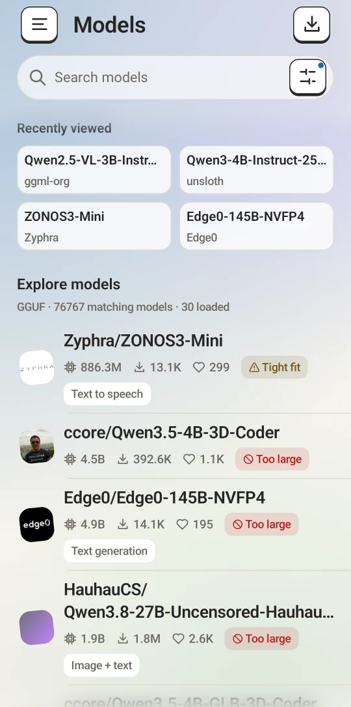
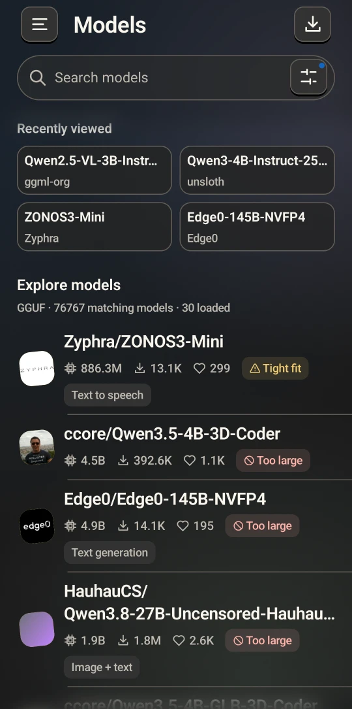
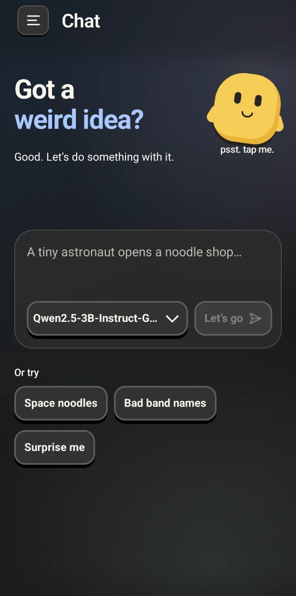
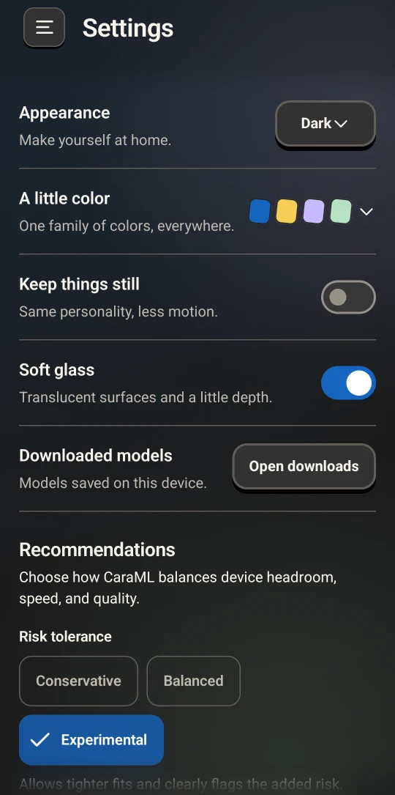
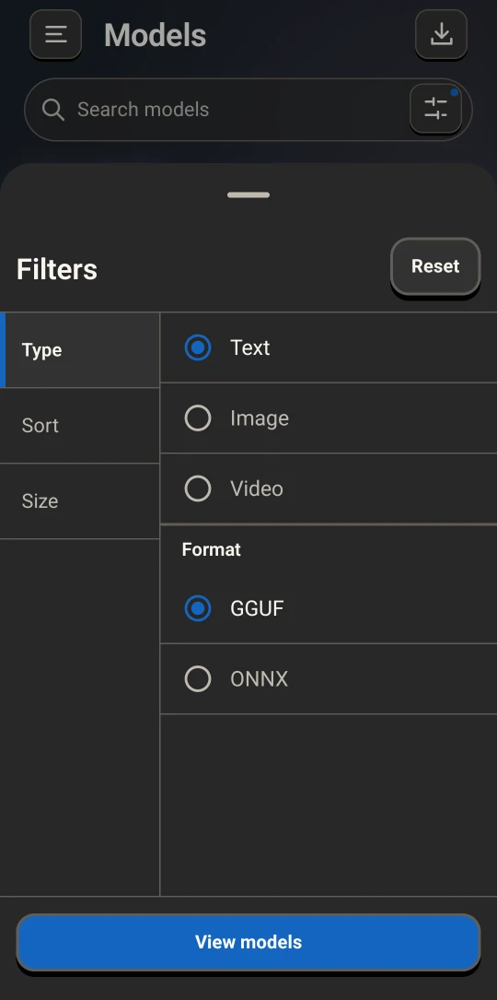
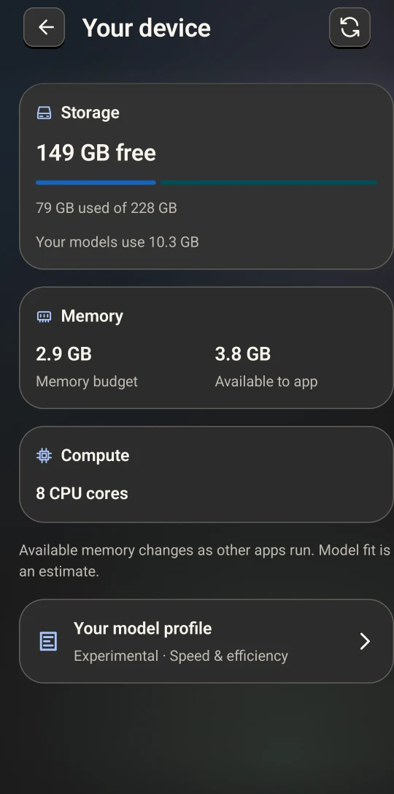
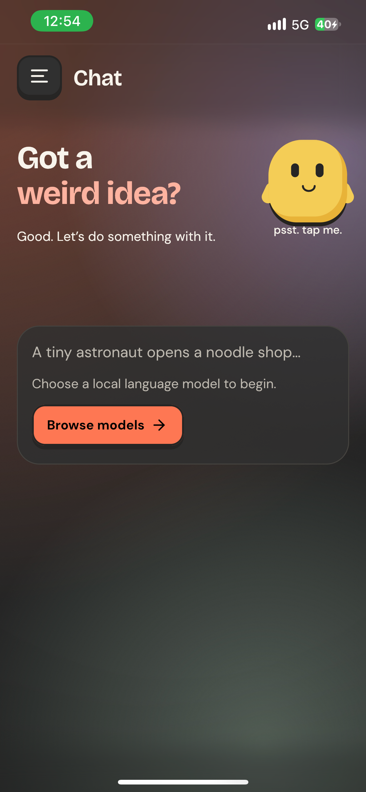
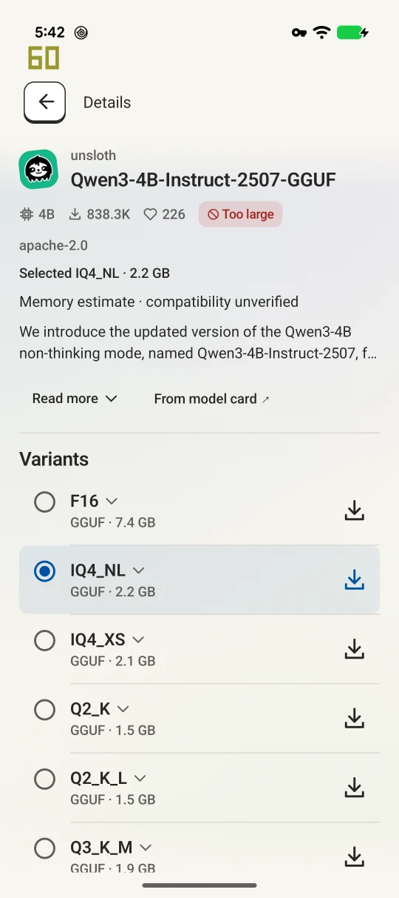
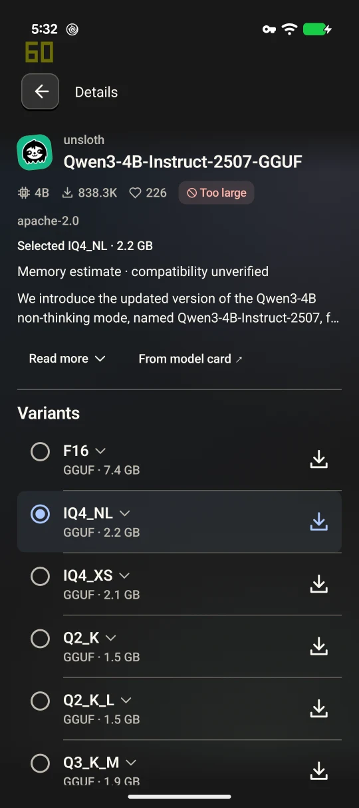

# CaraML demo

<video controls playsinline preload="none" poster="../assets/demo-poster.jpg" aria-label="CaraML local AI product walkthrough; text transcript follows">
  <source src="../assets/caraml-demo.mp4" type="video/mp4">
  <track kind="captions" src="../assets/caraml-demo.vtt" srclang="en" label="English" default>
  Your browser does not support inline video. Use the download link below.
</video>

[Download the MP4](assets/caraml-demo.mp4) · [Poster](assets/demo-poster.jpg)

The recording shows the earlier app layout. In current CaraML builds, search opens
directly from **Models**, and transfers and installed models live on **Downloads**.
See [Find and manage models](models.md#find-and-manage-models) for the current flow.

## Transcript

| Time | Visual and message |
| --- | --- |
| 0–4 s | “Your models. Your device.” CaraML's real Android start screen introduces local AI with Kotlin Multiplatform. |
| 4–14 s | “An idea in. An answer out.” A real Pixel 9 recording shows Qwen2.5 3B responding to “Give me three short names for a robot gardener.” |
| 14–19 s | “Choose your engine.” The installed model library introduces llama.cpp and ONNX Runtime for local text generation. |
| 19–21 s | “Picture it. Create it.” A real CaraML generation-in-progress recording introduces stable-diffusion.cpp. |
| 21–27 s | The completed SD-Turbo image is shown inside CaraML on the Pixel 9. |
| 27–32 s | “Make it local.” The completed conversation and repository URL invite developers to build CaraML. Commercial use requires permission. |

The generated answer was **BotTend**, **GreenBot**, and **SoilMate**. No voiceover or music is included; all explanatory copy is on screen and in this transcript.

## Capture details

- Captured **7 November 2026** from the installed CaraML Android app on a physical **Google Pixel 9, Android 17**.
- Chat model: **Qwen/Qwen2.5-3B-Instruct-GGUF**, `qwen2.5-3b-instruct-q4_k_m.gguf`, already downloaded.
- Image model: **Green-Sky/SD-Turbo-GGUF**, `sd_turbo-f16.gguf`, revision `19a31586d02d64a73b4419bc193b3ecfaf38e1f0`. The app downloads and verifies the weights before loading them.
- Image prompt: `A tiny blue robot watering flowers in a sunny garden, clay art, soft lighting`. Runtime logs record **512 × 512, 2 steps, CFG 1, Euler**, Vulkan diffusion with CPU text encoding, and the full untiled VAE.
- The conversation, model library, and image-generation screens are real app captures using public sample prompts.
- This is an **edited product walkthrough, not a benchmark**. Chat and image-generation footage is trimmed, and the completed image uses a held screenshot. Explanatory titles sit outside the captures. The eight-second image segment does not represent generation speed. The original chat capture did not independently record its runtime backend or exact APK commit.
- Use the [benchmark reports](benchmarks.md) for measured performance and complete workload conditions.

<details markdown>
<summary>Image-capture build provenance</summary>

The image-generation capture uses the Android Debug app built from [commit f0b1f2d](https://github.com/Debanshu777/CaraML/commit/f0b1f2d3055d97e54e4860bc2471801e6a8ca2ce). APK SHA-256: `b255501702014f9ba6d0f4efd4c4a70cc4e529a75cefd2f5da4e34aad4a33211`. Model SHA-256: `748f890c075c5d36df93a5ca47e382c7242cd10c2d1084861727f64fb4336540`.

</details>

## Product screenshots

In the current app, opening an installed model from Model Hub takes you to the matching workspace. Chat waits for loading to finish before accepting a new prompt. The captures below illustrate the original navigation and screens.

If you stop image or video generation before its result reaches the conversation, CaraML discards any files written for that turn. If Model Hub cannot fetch a model’s file list, the details screen offers a retry.

Model search and Downloads share compact rows. Search shows author avatars, server match counts, and model metadata. Downloads shows local file sizes, readiness, and selection controls. Open a search result to inspect model details or choose an installed model from Downloads to return to its workspace.

{ width="320" }

{ width="320" }

Captured in light and dark mode on a physical Pixel 9 running Android 17 on 14 November 2026. The four Recently viewed cards come from opening the corresponding Hugging Face models in the app. The refined hierarchy uses subdued history cards, a stronger Explore models heading, a shorter gap below search, lightly raised icon controls with 48dp touch targets, consistent dark shadows and subtle dark-mode rims, and a small active-filter dot in place of a numeric badge. The dark capture also shows the app-wide elevation palette: brighter raised containers over a quieter background. The captures below verify that the same rule applies to the Chat composer, Settings controls, filter sheet, and Device cards.

{ width="240" }
{ width="240" }
{ width="240" }
{ width="240" }

 The promotional captures below use the earlier layout.

Four coordinated product cards use Flow, the midnight-blue flower theme, and real app captures. Download the **1080 × 1920 PNGs** for presentations and future listing artwork; the README and docs load smaller WebP previews.

| Product card | Full-size artwork | Original capture |
| --- | --- | --- |
| Ideas in. Answers out. | [Local chat PNG](assets/product/01-local-chat.png) | [Pixel 9 chat](assets/screenshots/chat.png) |
| Your models. Your choice. | [Model library PNG](assets/product/02-model-library.png) | [Pixel 9 models](assets/screenshots/models.png) |
| Picture it. Create it. | [Image generation PNG](assets/product/03-image-generation.png) | [Pixel 9 SD-Turbo result](assets/screenshots/diffusion.png) |
| Feels at home. On iPhone. | [iPhone PNG](assets/product/04-iphone.png) | [iPhone 13 start screen](assets/screenshots/ios.png) |

The layouts add headlines, backgrounds, and generic device frames. App content and colors remain as captured; Flow and the blue palette apply to the surrounding documentation artwork. These are promotional assets for this source-distributed project, not links to an App Store or Play Store release.

## iPhone capture

{ width="320" }

Captured on 7 November 2026 after a successful Xcode Debug build and installation on a physical iPhone 13. This is the initial chat screen, not an iOS inference run; earlier measured iPhone workloads are in the [ONNX/GGUF report](https://github.com/Debanshu777/CaraML/blob/main/benchmarks/onnx/README.md).

## Recreate the video

The short story structure is inspired by [Brag](https://github.com/latent-spaces/brag). This native-app demo is composed locally with FFmpeg using actual device footage; it does not require Brag, Hyperframes, a hosted video service, or an API key.

```bash
python -m pip install -r tools/docs/media-requirements.txt
python tools/docs/render_demo.py --chat-video build/caraml-android-raw.mp4 --image-video build/caraml-diffusion-raw.mp4
```

Run after [setting up the docs environment and cover artwork](maintaining-docs.md). Supply your own raw Android chat recording, with the sample prompt sent around five seconds into the clip. Update the PNG screenshots in `docs/assets/screenshots/`, including `diffusion-progress.png` during real generation and `diffusion.png` after completion, then review the video before publishing. The renderer uses the app's bundled fonts and blue-flower background, and writes the MP4 and poster to `docs/assets/`. The cover renderer produces the social image separately. The video renderer also creates lossless WebP copies of the screenshots for faster page loading. Raw footage and intermediate clips stay in ignored `build/`.

The optional image recording should show generation underway at eight seconds. Omit `--image-video` to use the real progress screenshot instead; update the transcript to identify that segment as a still.

For a fresh capture, open CaraML, enter a public sample prompt, and record with Android's screen recorder or `adb shell screenrecord`. Keep only app content; do not include notifications, access tokens, or personal conversations. Recheck model labels and the transcript after changing footage.

Model rows show status through distinct icons and theme-aware colors, with full screen-reader descriptions. Details use the same recommendation presentation with visible text. Pipeline tasks appear as compact, noninteractive tags.

Model row compatibility appears as a tinted icon-and-text tag alongside the metrics, wrapping on narrow screens: green for likely fit/usable, amber for tight/risky, red for too large/incompatible, and neutral for checking or unknown evidence. Icon shapes and accessibility descriptions distinguish states without relying on color. Details keep the same verdict icon and color alongside explanatory text. Task names appear in rounded tags.

Shared model-row dividers align with the title column after the avatar and extend through the list’s trailing gutter to the content-pane edge.

Model-row avatars and selection icons are vertically centered beside the complete row content.

Model rows and details display `owner/model` as one title, with a smaller, regular-weight owner and slash in secondary text color and a semibold model name in primary text color. Existing device captures predate this typography treatment; when refreshing them, check size, weight, and color in light/dark mode, natural wrapping at large text sizes, and a model name without `/`.

Model search and Downloads now use the same `ModelRow` renderer and presentation-state contract. Existing row captures and interaction checks cover the shared layout; Downloads selection and setup repair, and search recommendation details remain distinct actions supplied by their callers.

## Model details captures

The current details screen uses the same frosted header configuration as search and shows the publisher excerpt fully expanded on every tab. The header reveals a compact model name once the main title scrolls out of view. The model-name portion of the inline title opens the publisher page and has a dotted underline. Variants, Model card, and Technical details use a flat text tab row with a short ink indicator and horizontal swipe navigation, including on desktop. The tab row pins directly below the top bar while scrolling, and selecting a pinned tab brings the start of that section into view. The full model name wraps without an expansion control. At enlarged text sizes the tab labels wrap, keeping every destination visible. Model card shows the complete README with images, tables, and relative links; the complete overview remains above this tab. Technical details separates prominent model specs, usage, repository dates/license, tags, and device fit into headed groups. The section divider spans both content edges; each file divider starts at the filename and reaches the trailing edge. The overview keeps the fit badge, while provisional fit explanations and their source are in Technical details. Avatar/title transitions, exact download actions, and reduced motion remain supported.

The reader and layout were checked again on **15 November 2026** in the debug app on the same physical Pixel 9. Live `Zyphra/ZONOS3-Mini` verified its README banner and article, and `HauhauCS/Qwen3.5-4B-Uncensored-HauhauCS-Aggressive` verified a complete long title, grouped technical facts, formatted context count, and final-section clearance above system navigation. Separate JVM fixtures verified light/dark rendering, all three tabs at 320dp/200% text, wrapping tables, keyboard activation, relative links, and deterministic image success/failure. A follow-up check on the live `HauhauCS/Qwen3.8-27B-Uncensored-HauhauCS-Aggressive-MTP-GGUF` page verified that Model card retains the overview, the header uses search’s shared frost settings, and scrolling past the main title reveals the compact header name. The sticky-tab update was also checked while reading further down that live README and switching directly to Variants and Technical details; their first content remained below the pinned row. The final lifecycle check rotated the Pixel between portrait and landscape on this page: Model card remained selected, and an idle round trip restored the same visible README and tab coordinates. Switching through all three pinned tabs also passed after rotation. The original portrait rotation-lock setting was restored. These checks did not include iOS or a full screen-reader audit.

The device captures below predate the frosted back-only header, three text tabs, grouped technical details, expanded excerpt, inline link, and divider changes. They document the earlier screen. Current JVM renders use fixture data and must not be presented as live Hub captures.

{ width="320" }
{ width="320" }

Captured from the debug app on a physical Pixel 9 running Android 17 on **14 November 2026**, using live data for `unsloth/Qwen3-4B-Instruct-2507-GGUF`. Both themes show the same manually selected IQ4_NL variant, including the restrained row tint, flat action icon, and equal side gutters. The small green number is the phone's refresh-rate overlay. These captures are resized for documentation; no model download was started. The review also checked selected-and-expanded filenames in both themes, light/dark rendered contrast, a wide layout, and 200% text fixtures. Fixtures verify layout and are not presented as live Hub data.

Capture the actual app after opening a model from search. Check that the title starts clear of the frosted back-only header, then scroll content behind it and verify that the model name appears in the header. Scroll back and verify that the header name disappears without a layout shift. Check that the expanded description stays visible when switching tabs, tap only the model-name link, scroll well into a README and switch the pinned tabs by tap and swipe, verify that short sections start below the row, scroll back to unpin it, and inspect README images, wrapping tables and relative links, the technical groups, edge-aligned dividers, long filenames, dark mode, and a narrow layout at 200% text size. Rotate while reading a model card and confirm the selected tab and reading offset restore without a loading reset, then switch through all three tabs. Repeat with Soft effects disabled to check the opaque fallback. The model-card request must not delay file selection or replace an older/newer route’s text. Do not represent Compose fixtures as live Hub data.

### Review cleanup verification

Obsolete Model Hub toolbar/context/summary components were removed from production sources, and their tests now target current controls. This cleanup does not introduce a new screen design; the captures above remain historical evidence, not captures of this change. Recently viewed still shows the same compact cards while storing only display fields, and history persistence no longer delays the file list. Cancellation may show **Cancellation cleanup pending** until staged files are removed; verify retry and restart recovery in the download regressions. No new device screenshots or performance measurements are claimed for this maintenance change.

Retained-details regression checks simulate removal between visits to the same model: installation actions refresh while the retained README and remote request counts stay unchanged. Legacy layout fixtures now pass header/context/snackbar content explicitly. These are automated maintenance checks; no new device captures are included.
