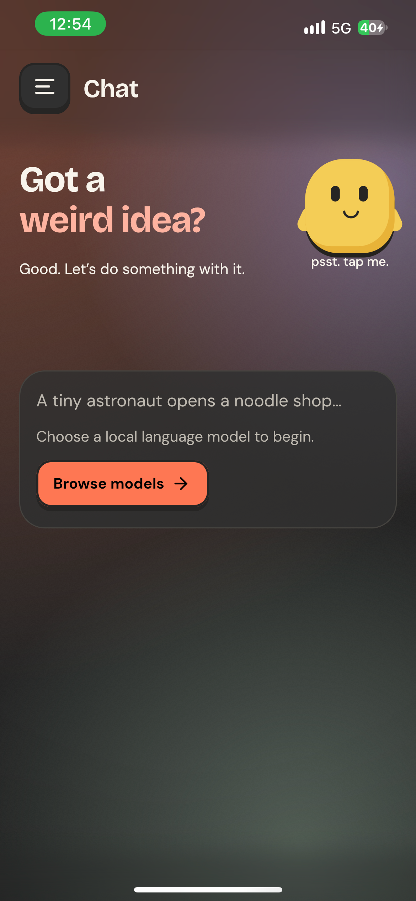

# CaraML demo

<video controls playsinline preload="none" poster="../assets/demo-poster.jpg" aria-label="CaraML local AI product walkthrough; text transcript follows">
  <source src="../assets/caraml-demo.mp4" type="video/mp4">
  <track kind="captions" src="../assets/caraml-demo.vtt" srclang="en" label="English" default>
  Your browser does not support inline video. Use the download link below.
</video>

[Download the MP4](assets/caraml-demo.mp4) · [Poster](assets/demo-poster.jpg)

## Transcript

| Time | Visual and message |
| --- | --- |
| 0–4 s | “Your models. Your device.” CaraML's real Android start screen introduces local AI with Kotlin Multiplatform. |
| 4–14 s | “An idea in. An answer out.” A real Pixel 9 recording shows Qwen2.5 3B responding to “Give me three short names for a robot gardener.” |
| 14–19 s | “Choose your engine.” The installed model library introduces llama.cpp and ONNX Runtime for local text generation. |
| 19–21 s | “Picture it. Create it.” A real CaraML generation-in-progress recording introduces stable-diffusion.cpp. |
| 21–27 s | The completed SD-Turbo image is shown inside CaraML on the Pixel 9. |
| 27–32 s | “Make it local.” The completed conversation and repository URL invite developers to build CaraML. Commercial use requires permission. |

The generated answer was **BotTend**, **GreenBot**, and **SoilMate**. No voiceover or music is included; all explanatory copy is on screen and in this transcript.

## Capture details

- Captured **7 November 2026** from the installed CaraML Android app on a physical **Google Pixel 9, Android 17**.
- Chat model: **Qwen/Qwen2.5-3B-Instruct-GGUF**, `qwen2.5-3b-instruct-q4_k_m.gguf`, already downloaded.
- Image model: **Green-Sky/SD-Turbo-GGUF**, `sd_turbo-f16.gguf`, revision `19a31586d02d64a73b4419bc193b3ecfaf38e1f0`. The app downloads and verifies the weights before loading them.
- Image prompt: `A tiny blue robot watering flowers in a sunny garden, clay art, soft lighting`. Runtime logs record **512 × 512, 2 steps, CFG 1, Euler**, Vulkan diffusion with CPU text encoding, and the full untiled VAE.
- The conversation, model library, and image-generation screens are real app captures using public sample prompts.
- This is an **edited product walkthrough, not a benchmark**. Chat and image-generation footage is trimmed, and the completed image uses a held screenshot. Explanatory titles sit outside the captures. The eight-second image segment does not represent generation speed. The original chat capture did not independently record its runtime backend or exact APK commit.
- Use the [benchmark reports](benchmarks.md) for measured performance and complete workload conditions.

<details markdown>
<summary>Image-capture build provenance</summary>

The image-generation capture uses the Android Debug app built from [commit f0b1f2d](https://github.com/Debanshu777/CaraML/commit/f0b1f2d3055d97e54e4860bc2471801e6a8ca2ce). APK SHA-256: `b255501702014f9ba6d0f4efd4c4a70cc4e529a75cefd2f5da4e34aad4a33211`. Model SHA-256: `748f890c075c5d36df93a5ca47e382c7242cd10c2d1084861727f64fb4336540`.

</details>

## Product screenshots

In the current app, opening an installed model from Model Hub takes you to the matching workspace. Chat waits for loading to finish before accepting a new prompt. The captures below illustrate the original navigation and screens.

If you stop image or video generation before its result reaches the conversation, CaraML discards any files written for that turn. If Model Hub cannot fetch a model’s file list, the details screen offers a retry.

Four coordinated product cards use Flow, the midnight-blue flower theme, and real app captures. Download the **1080 × 1920 PNGs** for presentations and future listing artwork; the README and docs load smaller WebP previews.

| Product card | Full-size artwork | Original capture |
| --- | --- | --- |
| Ideas in. Answers out. | [Local chat PNG](assets/product/01-local-chat.png) | [Pixel 9 chat](assets/screenshots/chat.png) |
| Your models. Your choice. | [Model library PNG](assets/product/02-model-library.png) | [Pixel 9 models](assets/screenshots/models.png) |
| Picture it. Create it. | [Image generation PNG](assets/product/03-image-generation.png) | [Pixel 9 SD-Turbo result](assets/screenshots/diffusion.png) |
| Feels at home. On iPhone. | [iPhone PNG](assets/product/04-iphone.png) | [iPhone 13 start screen](assets/screenshots/ios.png) |

The layouts add headlines, backgrounds, and generic device frames. App content and colors remain as captured; Flow and the blue palette apply to the surrounding documentation artwork. These are promotional assets for this source-distributed project, not links to an App Store or Play Store release.

## iPhone capture

{ width="320" }

Captured on 7 November 2026 after a successful Xcode Debug build and installation on a physical iPhone 13. This is the initial chat screen, not an iOS inference run; earlier measured iPhone workloads are in the [ONNX/GGUF report](https://github.com/Debanshu777/CaraML/blob/main/benchmarks/onnx/README.md).

## Recreate the video

The short story structure is inspired by [Brag](https://github.com/latent-spaces/brag). This native-app demo is composed locally with FFmpeg using actual device footage; it does not require Brag, Hyperframes, a hosted video service, or an API key.

```bash
python -m pip install -r tools/docs/media-requirements.txt
python tools/docs/render_demo.py --chat-video build/caraml-android-raw.mp4 --image-video build/caraml-diffusion-raw.mp4
```

Run after [setting up the docs environment and cover artwork](maintaining-docs.md). Supply your own raw Android chat recording, with the sample prompt sent around five seconds into the clip. Update the PNG screenshots in `docs/assets/screenshots/`, including `diffusion-progress.png` during real generation and `diffusion.png` after completion, then review the video before publishing. The renderer uses the app's bundled fonts and blue-flower background, and writes the MP4 and poster to `docs/assets/`. The cover renderer produces the social image separately. The video renderer also creates lossless WebP copies of the screenshots for faster page loading. Raw footage and intermediate clips stay in ignored `build/`.

The optional image recording should show generation underway at eight seconds. Omit `--image-video` to use the real progress screenshot instead; update the transcript to identify that segment as a still.

For a fresh capture, open CaraML, enter a public sample prompt, and record with Android's screen recorder or `adb shell screenrecord`. Keep only app content; do not include notifications, access tokens, or personal conversations. Recheck model labels and the transcript after changing footage.
