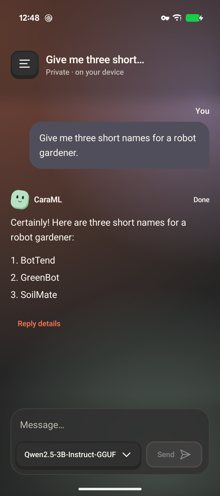
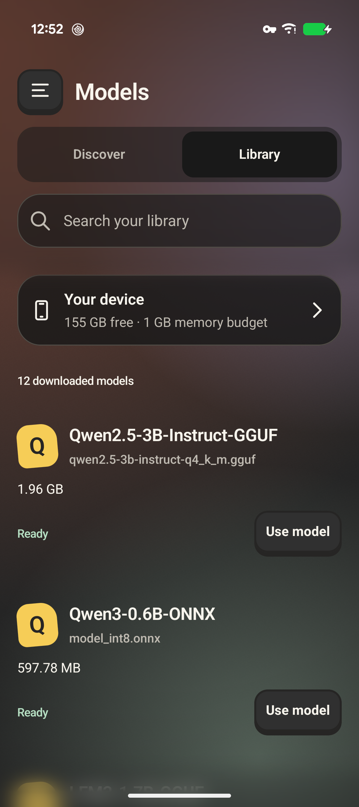
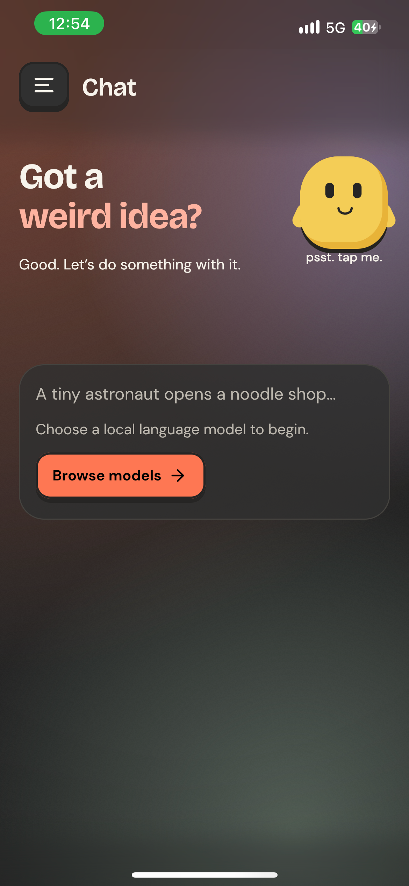

Kotlin Multiplatform · On-device inference

# Your models. Your device.

Chat with a local language model. Turn a prompt into an image. Explore Hugging Face, download a supported model, and run inference on your own hardware with CaraML.

[Build and run](getting-started.md){ .md-button .md-button--primary }
[Watch the demo](demo.md){ .md-button }
[View the source](https://github.com/Debanshu777/CaraML){ .md-button }

  <figure><figcaption>Chat with a local model</figcaption></figure>
  <figure><figcaption>Choose your model</figcaption></figure>
  <figure><figcaption>On iPhone, too</figcaption></figure>

Screens captured from CaraML on a Pixel 9 and an iPhone 13. [Capture details and demo transcript](demo.md).

## Local inference, shared Kotlin

CaraML is a **Kotlin Multiplatform and Compose Multiplatform AI application** targeting Android, iOS, and JVM desktop. It combines llama.cpp for GGUF language models, ONNX Runtime for supported text bundles, and stable-diffusion.cpp for image generation. Model discovery and downloads use Hugging Face Hub.

Inference runs locally after model download. Browsing and downloading require a network connection; gated models may require a Hugging Face token and acceptance of the model's terms. No cloud inference API key is required.

| You want to… | Start here |
| --- | --- |
| Run the app on your own device | [Build and run](getting-started.md) |
| Find a model that fits | [Formats, hardware, and compatibility](models.md) |
| Learn from the KMP implementation | [Architecture and module map](architecture.md) |
| Explore the experimental SDK | [SDK boundaries and limits](architecture.md#sdk-boundaries-and-ownership) |
| Fix a bug or improve the docs | [Contribution guide](development.md) |
| Evaluate performance claims | [Reproducible benchmarks](benchmarks.md) |

## What works today

- **Streaming chat:** markdown responses, cancellation, and reasoning blocks for models that emit them.
- **Model management:** browse, search, filter, and download models; durable transfers support pause, resume, and recovery.
- **Image generation:** model-specific diffusion plans and configurable sampling. [Measured Android results](https://github.com/Debanshu777/CaraML/blob/main/benchmarks/diffusion/README.md) describe tested models and limits.
- **Native acceleration:** Vulkan for supported Android GGUF workloads and Metal on Apple platforms. Supported ONNX dynamic-cache exports currently use CPU in the app.
- **Adaptive UI:** shared Compose screens with light/dark appearance, reduced-motion controls, and desktop navigation.

## Project status

CaraML is under active development and currently distributed as source. There are no published binary releases or Maven Central SDK coordinates. Build from this repository; the SDK contracts are experimental and do not yet promise source or binary compatibility.

Android and Apple device measurements are documented. Linux has a CPU desktop path; Windows packaging is configured but is not presented as a verified release. Video generation is not advertised as a validated feature.

## Source available, with clear commercial terms

CaraML uses **PolyForm Noncommercial 1.0.0**. Noncommercial use is permitted under that license; commercial use requires separate written permission. Dependencies and model weights retain their own licenses. [Read the license and request commercial permission](licensing.md).
