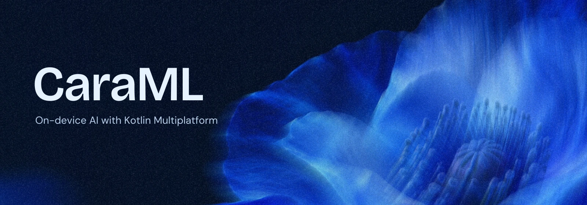
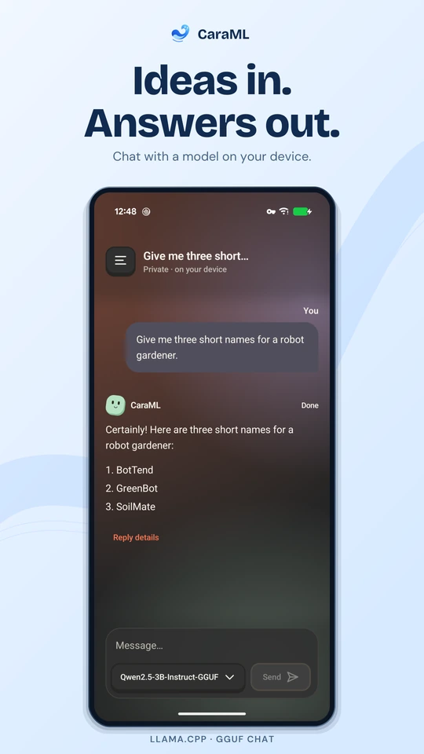
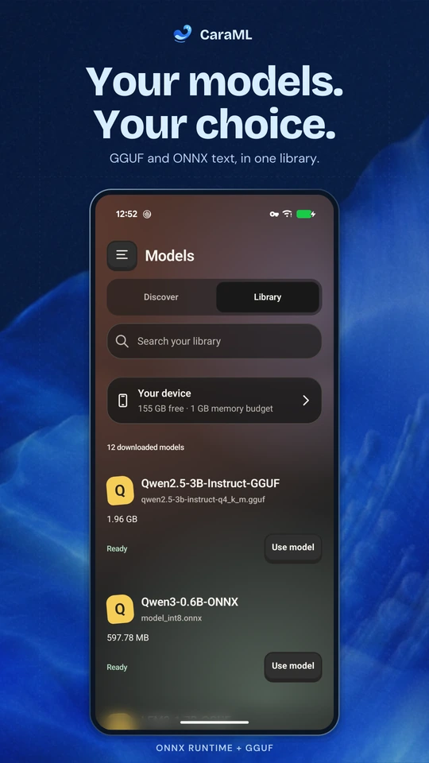
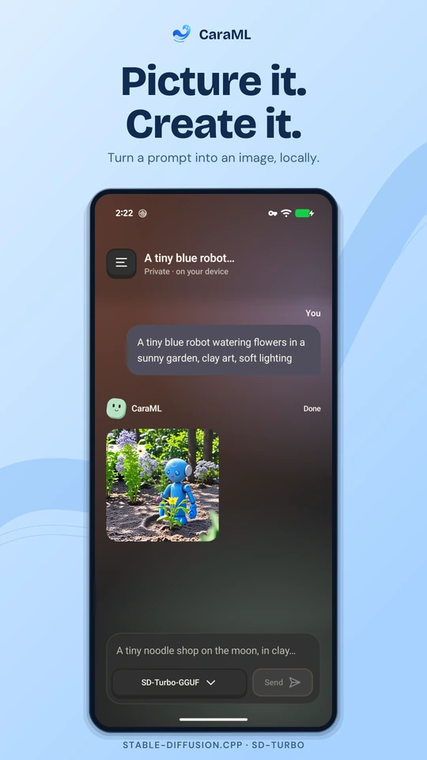
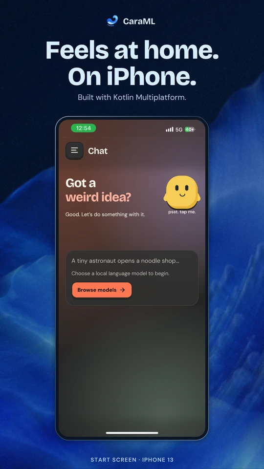

# CaraML

Models separates recent visits from the discovery list with distinct section headings and compact search controls with lightly raised icon buttons and theme-aware contrast. Dark mode uses lighter raised surfaces, subtle borders, and dark shadows across navigation, workspaces, models, and settings.

Model details keeps the owner and model name in one styled title, with a dotted-underlined link on the model name. The header uses search’s frosted treatment and reveals the model name after the expanded title scrolls out of view. Full model names and publisher descriptions remain expanded above every tab. Three flat swipeable tabs stay available below the top bar while scrolling and show variants, the complete model card with images/tables/relative links, and grouped technical facts. Section and file dividers remain edge-aligned. Configuration changes reuse loaded details and preserve the selected tab; tab changes reuse the prepared README. Reopening details refreshes installation status after a model is removed from Downloads. See [what details can show](models.md#model-details).

CaraML runs language models and image generation on Android, iOS, and desktop. It is built with Kotlin and Compose Multiplatform, with model discovery and downloads through Hugging Face.

[**Build and run →**](getting-started.md) · [Supported models](models.md) · [Demo](demo.md) · [Source](https://github.com/Debanshu777/CaraML)

**Engines:** llama.cpp for GGUF chat, ONNX Runtime for supported text bundles, and stable-diffusion.cpp for image generation.

  
  
  
  

Real Pixel 9 and iPhone 13 captures in store-style layouts. Select a card for the full-size image. [Capture details and original screenshots](demo.md#product-screenshots).

## Local inference, shared Kotlin

CaraML is a **Kotlin Multiplatform and Compose Multiplatform AI application** targeting Android, iOS, and JVM desktop. It combines llama.cpp for GGUF language models, ONNX Runtime for supported text bundles, and stable-diffusion.cpp for image generation. Model discovery and downloads use Hugging Face Hub.

Inference runs locally after model download. Browsing and downloading require a network connection; gated models may require a Hugging Face token and acceptance of the model's terms. No cloud inference API key is required.

| You want to… | Start here |
| --- | --- |
| Run the app on your own device | [Build and run](getting-started.md) |
| Find a model that fits | [Formats, hardware, and compatibility](models.md) |
| Learn from the KMP implementation | [Architecture and module map](architecture.md) |
| Explore the experimental SDK | [SDK boundaries and limits](architecture.md#sdk-boundaries-and-ownership) |
| Fix a bug or improve the docs | [Contribution guide](development.md) |
| Evaluate performance claims | [Reproducible benchmarks](benchmarks.md) |

## What works today

- **Streaming chat:** markdown responses, cancellation, and reasoning blocks for models that emit them.
- **Model management** includes paged Hugging Face search, match counts, author avatars, recent visits, and installed-variant counts. The Downloads page combines the durable transfer queue and searchable local models. Supported queue upgrades preserve records and checkpoints; unsafe legacy work stays quarantined. Installed models open their matching workspace, and ONNX removal respects shared companion files.
- **Download recovery:** interrupted cancellation cleanup is retried, active work remains visible alongside failure history, and incomplete installations can be removed with shared-file protection. [Removal limits](models.md#removing-incomplete-installations).
- **Image generation:** model-specific diffusion plans and configurable sampling. [Measured Android results](https://github.com/Debanshu777/CaraML/blob/main/benchmarks/diffusion/README.md) describe tested models and limits.
- **Native acceleration:** Vulkan for supported Android GGUF workloads and Metal on Apple platforms. Supported ONNX dynamic-cache exports currently use CPU in the app.
- **Adaptive UI:** shared Compose screens with light/dark appearance, reduced-motion controls, and desktop navigation.

## Project status

CaraML is under active development and currently distributed as source. There are no published binary releases or Maven Central SDK coordinates. Build from this repository; the SDK contracts are experimental and do not yet promise source or binary compatibility.

Android and Apple device measurements are documented. Linux has a CPU desktop path; Windows packaging is configured but is not presented as a verified release. Video generation is not advertised as a validated feature.

## Source available, with clear commercial terms

CaraML uses **PolyForm Noncommercial 1.0.0**. Noncommercial use is permitted under that license; commercial use requires separate written permission. Dependencies and model weights retain their own licenses. [Read the license and request commercial permission](licensing.md).
